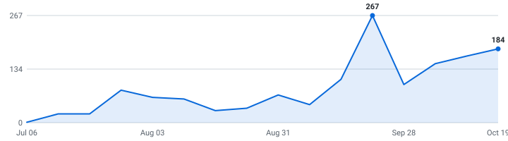

# 🎓 New Grad Tech Jobs

**A self-updating engine that tracks new grad tech roles for the Class of 2027 and Class of 2026 so you don't have to.**

&nbsp;&nbsp;&nbsp;

### 976 open roles (550 listed below) · 160 new this week

5,015 employers tracked · data as of Oct 25, 2026 at 21:02 UTC

_536 have a class year the employer stated · 440 are recent postings whose class year isn't stated (listed separately, never mixed in)._

**[🖥️ Live dashboard](https://apxxrv.github.io/New-Grad-Tech-Jobs/)** · **[📡 RSS](https://apxxrv.github.io/New-Grad-Tech-Jobs/feed.xml)** · **[⚙️ JSON API](https://apxxrv.github.io/New-Grad-Tech-Jobs/api/jobs.json)** · **[✉️ RSS-to-email](https://feedrabbit.com/subscriptions/new?url=https%3A%2F%2Fraw.githubusercontent.com%2Fapxxrv%2FNew-Grad-Tech-Jobs%2Fmain%2Fdocs%2Ffeed.xml)**

> [!TIP]
> **⭐ Star this repo** to save it and get updates when new roles are added.

Instead of refreshing a dozen career pages by hand, it reads company hiring feeds directly and keeps one live list — newest roles on top, refreshed automatically throughout the day.

**🔔 New roles in your inbox:** native email digests are not configured for this repo. Use [Feedrabbit RSS-to-email](https://feedrabbit.com/subscriptions/new?url=https%3A%2F%2Fraw.githubusercontent.com%2Fapxxrv%2FNew-Grad-Tech-Jobs%2Fmain%2Fdocs%2Ffeed.xml) or subscribe to the [RSS feed](https://apxxrv.github.io/New-Grad-Tech-Jobs/feed.xml). Feedrabbit is a separate service; delivery follows its own plan and schedule.

---

## What this is

This is an engine, not a hand-kept list. It is scheduled to poll company career feeds every 30 minutes, find new grad roles, remove duplicates, and rebuild this page. GitHub Actions can delay or skip scheduled runs; the data-as-of timestamp above shows the last completed refresh.

Every link comes straight from the source — so it's real and current, not a stale list someone forgot to update. Speed matters.

## What makes this different

| | |
|---|---|
| 📅 **[Drop Radar](#drop-radar)** | A forecast of **what's coming**. Each marquee company's typical opening window, replaced by the real drop date the moment the engine catches it live. Windows are estimates and labelled as such; only dates the engine saw itself are marked verified. |
| 🛂 **Visa intel, computed** | 🇺🇸 / 🛂 flags detected automatically from every job description, plus ✓ for employers with a real H-1B track record (USCIS data, FY2022-23 — a history, not a promise). The big lists crowdsource this by hand; here it's code. Most postings say nothing either way, and those show as unknown rather than guessed. |
| 📆 **A real date on nearly every role** | Taken from the job portal itself wherever the portal states one, so newest-first actually means newest. The exact coverage figure is printed at the bottom of this page every run. |
| 🧰 **Skill tags + pay, extracted** | Every posting's text is scanned for the stack it wants (Python, C++, PyTorch, …) and the pay it states — searchable on the [dashboard](https://apxxrv.github.io/New-Grad-Tech-Jobs/), and included in the CSV and API. |
| 🔔 **Alerts your way** | [RSS-to-email](https://feedrabbit.com/subscriptions/new?url=https%3A%2F%2Fraw.githubusercontent.com%2Fapxxrv%2FNew-Grad-Tech-Jobs%2Fmain%2Fdocs%2Ffeed.xml) or [RSS](https://apxxrv.github.io/New-Grad-Tech-Jobs/feed.xml) — point any reader, or a Slack/Discord RSS integration, at it. Plus a [live dashboard](https://apxxrv.github.io/New-Grad-Tech-Jobs/) with search, filters, and a saved-roles list that never leaves your browser. |
| ⚙️ **An engine, not a spreadsheet** | 5,334 job-board endpoints (5,015 distinct employers; some run more than one board) scheduled for polling every 30 minutes. Full source and tests in this repo. |

## Scope

| | |
|---|---|
| **Roles** | Software Engineering, Data Science & Machine Learning (and closely related technical new grad roles) |
| **Region** | United States |
| **Class years** | Class of 2027 and Class of 2026 |

## About

I'm an international student in the United States, graduating soon, and this is the search I'm doing myself. I forked zshah101's internship engine and pointed it at new grad roles instead, because the same boards, the same sponsorship signals, and the same speed advantage all carry over. The list is US roles only for now — that's where I'm searching.

**Built on** [zshah101/Automated-List-Of-Summer-2027-and-Fall-2026-Tech-Internships](https://github.com/zshah101/Automated-List-Of-Summer-2027-and-Fall-2026-Tech-Internships) (MIT).

Use it to spot roles early and apply before they fill up. Being first genuinely helps.

## Where this is going

I'm building this in the open and adding to it as it grows.

**Available:** rss-to-email · the Drop Radar · auto-detected sponsorship flags · the live dashboard

**Next up:** personalized alerts (pick your categories) · per-company hiring pages · a ghost-posting detector

If it helps you, a star means a lot and tells me to keep going.

## How to use

<b>Reading the table — flags, dates, and the class year split</b> (click to expand)

- Roles are grouped by class year below - **newest posting on top, oldest at the bottom.**
- A class year section holds only roles whose **employer stated that class year** - in the title, or in the posting's own text. Postings that name no class year anywhere are in *Recently posted — class year not stated* further down, with **no class year guessed for them**. Same quality bar, different amount of evidence.
- **Apply** is the third column, right after the role, so the link is on screen even when the table is wider than your window.
- The **Posted** column is the date the company published the role.
- **_(3 openings)_ after a role title** = the employer has that many separate live requisitions for the same job, in the same place, for the same class year. They're all real and each takes its own application, so they're linked individually (**Apply**, then **#2**, **#3**) instead of repeating the row. Counts still count requisitions, and the CSV export is never grouped.
- **🆁 after a company name** = **this role is remote** — the posting's own location or title says so. It marks the role on that row, not the whole company.
- **Flags after a role title:** 🇺🇸 = requires U.S. citizenship or a security clearance · 🛂 = the posting says it won't sponsor a work visa · 🆕 = spotted in the last 48 hours. Sponsorship flags are detected automatically from each job description - treat them as a strong hint and confirm on the posting.
- **✓ after a company name** = a real H-1B track record: USCIS approved 10+ petitions for that employer in FY2022–2023 (matched automatically against the official [H-1B Employer Data Hub](https://www.uscis.gov/tools/reports-and-studies/h-1b-employer-data-hub)). No ✓ doesn't mean they won't sponsor - it means we can't prove they have.
- Track your applications with [`data/new_grad_jobs.csv`](data/new_grad_jobs.csv) (opens in Excel / Google Sheets).
- Missing a company? Adding one takes a single line, see [CONTRIBUTING.md](CONTRIBUTING.md).

---

## Class of 2027  (157 employer-stated)

| Company | Role | Apply | Location | Skills | Posted |
|---|---|---|---|---|---|
| Guidehouse ✓ 🆁 | IT Cybersecur​ity Compliance Technical Associate- Campus 2027 🆕 | [Apply](https://guidehouse.wd1.myworkdayjobs.com/external/job/US---VA-McLean/IT-Cybersecurity-Compliance-Technical-Associate--Campus-2027_45899) | US - VA +7 more | No skills listed | Oct 25, 2026 |
| Northrop Grumman | 2027 Associate Embedded Software Engineer - Morrisville NC 🇺🇸 🆕 | [Apply](https://ngc.wd1.myworkdayjobs.com/Northrop_Grumman_External_Site/job/United-States-North-Carolina-Morrisville/XMLNAME-2027-Associate-Embedded-Software-Engineer---Morrisville-NC_R10257541) | United States-North Carolina-Morrisville | No skills listed | Oct 25, 2026 |
| Citi | Technology, Cyber Security, Summer Analyst, Irving - USA, 2027 🆕 | [Apply](https://citi.wd5.myworkdayjobs.com/2/job/Irving-Texas-United-States/Technology--Cyber-Security--Summer-Analyst--Irving---USA--2027_26999482) | Irving Texas United States | Java, TypeScript, LLMs, React | Oct 23, 2026 |
| Palantir ✓ | Forward Deployed Software Engineer, New Grad - Warp Speed 🇺🇸 | [Apply](https://jobs.lever.co/palantir/66b495eb-aaf9-4bf9-a759-41854534add7) | New York, NY | Python, Java, C++, TypeScript | Oct 22, 2026 |
| Booz Allen | University, Software Developer 🇺🇸 | [Apply](https://bah.wd1.myworkdayjobs.com/Confidential/job/McLean-VA/University--Software-Developer_R0252280) | McLean +22 more | Python, Java, C++, JavaScript | Oct 22, 2026 |
| Guidehouse ✓ | Technical Associate Application Developer - Campus 2027 | [Apply](https://guidehouse.wd1.myworkdayjobs.com/external/job/US---IL-Chicago/Technical-Associate-Application-Developer---Campus-2027_45783) | US - IL, Chicago | Python, JavaScript, SQL, React | Oct 22, 2026 |
| Rendezvous Robotics | Flight Software Engineer (Early Career) | [Apply](https://job-boards.greenhouse.io/rendezvousrobotics/jobs/4464270009) | Golden, CO | Python, C++, Linux, Git | Oct 22, 2026 |
| Global​Foundries | AI Software Engineer (2027 New College Graduate) | [Apply](https://globalfoundries.wd1.myworkdayjobs.com/External/job/USA---California---Santa-Clara/AI-Software-Engineer--2027-New-College-Graduate-_JR-2604055) | USA - California - Santa Clara +2 more | PyTorch, TensorFlow, Computer Vision, AWS | Oct 21, 2026 |
| ByteDance ✓ | Research Scientist Graduate (Seed Model-Alignment&​Preparedne​ss) - 2027 Start | [Apply](https://joinbytedance.com/search/7698902624003229957) | San Jose, California, USA | Python, PyTorch, LLMs | Oct 20, 2026 |
| ByteDance ✓ | Research Scientist Graduate (Seed Model-Alignment&​Preparedne​ss) - 2027 Start (PhD) | [Apply](https://joinbytedance.com/search/7698902624389482757) | San Jose, California, USA | Python, PyTorch, LLMs | Oct 20, 2026 |
| CVS Health | Full-Stack Engineer Training Program - June 2027 Cohort 🛂 | [Apply](https://cvshealth.wd1.myworkdayjobs.com/CVS_Health_Careers/job/CT---Work-from-home/Full-Stack-Engineer-Training-Program---June-2027-Cohort_R1066830) | CT - Work from home +50 more | Python, LLMs, AWS, GCP | Oct 20, 2026 |
| JPMorgan​Chase ✓ | 2027 Machine Learning Center of Excellence (NLP) - Summer Associate | [Apply](https://jpmc.fa.oraclecloud.com/hcmUI/CandidateExperience/en/sites/CX_1001/job/210801790) | New York +8 more | Python, PyTorch, TensorFlow, scikit-learn | Oct 20, 2026 |
| The Aerospace Corporation | 2027 Aerospace Software and Simulation Engineer 🇺🇸 | [Apply](https://aero.wd5.myworkdayjobs.com/external/job/El-Segundo-CA/XMLNAME-2027-Aerospace-Software-and-Simulation-Engineer_R016883) | El Segundo, CA | Python, Java, C++, Linux | Oct 19, 2026 |
| Global​Foundries | AI/ML Systems Engineer (2027 New College Graduate) | [Apply](https://globalfoundries.wd1.myworkdayjobs.com/External/job/USA---Texas---Richardson/AI-ML-Systems-Engineer--2027-New-College-Graduate-_JR-2604163) | USA - Texas - Richardson | Python, PyTorch, TensorFlow, Pandas | Oct 19, 2026 |
| Graviton | Quantitative Researcher - 2027 Graduates | [Apply](https://job-boards.greenhouse.io/gravitonresearchcapital/jobs/8899670002) | Amsterdam +7 more | Python, C++ | Oct 19, 2026 |
| Northrop Grumman | 2027 Associate Embedded Software Engineer Beavercreek Ohio 🇺🇸 | [Apply](https://ngc.wd1.myworkdayjobs.com/Northrop_Grumman_External_Site/job/United-States-Ohio-Beavercreek/XMLNAME-2027-Associate-Embedded-Software-Engineer-Beavercreek-Ohio_R10256623) | United States-Ohio-Beavercreek | C++, Rust, Linux, Git | Oct 19, 2026 |
| Northrop Grumman | 2027 Associate/Software Engineer Pathways Linthicum MA 🇺🇸 | [Apply](https://ngc.wd1.myworkdayjobs.com/Northrop_Grumman_External_Site/job/United-States-Maryland-Linthicum/XMLNAME-2027-Associate-Software-Engineer-Pathways-Dulles-VA_R10256499) | United States-Maryland-Linthicum | No skills listed | Oct 19, 2026 |
| Together AI | Hardware Security Engineer, New Grad (2027) | [Apply](https://job-boards.greenhouse.io/togetherai/jobs/5238471007) | San Francisco | Python, Bash | Oct 16, 2026 |
| Mastercard | AI Engineer I, Launch Program 2027 – St. Louis, MO, US | [Apply](https://mastercard.wd1.myworkdayjobs.com/Campus/job/OFallon-Missouri/AI-Engineer-I--Launch-Program-2027---St-Louis--MO--US_R-284852) | O'Fallon, Missouri | LLMs | Oct 16, 2026 |
| TikTok ✓ | Backend Engineer Graduate (Account) - 2027 Start | [Apply](https://lifeattiktok.com/search/7696779797359233333) | San Jose, California, USA | Python, Java, C++ | Oct 15, 2026 |
| TikTok ✓ | Backend Engineer Graduate (Social Foundation) - 2027 Start | [Apply](https://lifeattiktok.com/search/7696782198126545157) | San Jose, California, USA | Python, Java, C++ | Oct 15, 2026 |
| LSEG | Quant Analyst | [Apply](https://lseg.wd3.myworkdayjobs.com/Careers/job/Boston-Massachusetts/Quant-Analyst_R0123224) | Boston, Massachuse​tts | Python, C++, Git | Oct 15, 2026 |
| SpaceX | New Graduate Engineer, Infrastruc​ture | [Apply](https://boards.greenhouse.io/spacex/jobs/8893406002?gh_jid=8893406002) | Starbase, TX | Python, MATLAB | Oct 15, 2026 |
| DXC Technology | 2027 Graduate - AI & Innovation Full Stack Engineer | [Apply](https://dxctechnology.wd1.myworkdayjobs.com/dxcjobs/job/AUS---VIC---MELBOURNE/XMLNAME-2027-Graduate---AI---Innovation-Full-Stack-Engineer_51591714) | AUS - VIC - MELBOURNE +6 more | No skills listed | Oct 14, 2026 |
| Macy's | Macy's 2027 Tech Early Careers - Software Engineer | [Apply](https://ebwh.fa.us2.oraclecloud.com/hcmUI/CandidateExperience/en/sites/CX_1001/job/91780) | Johns Creek, GA, United States | Python, Java, JavaScript, SQL | Oct 14, 2026 |
| NVIDIA ✓ | SoC Software Engineer - New College Grad 2027 | [Apply](https://nvidia.wd5.myworkdayjobs.com/NVIDIAExternalCareerSite/job/US-CA-Santa-Clara/SoC-Software-Engineer---New-College-Grad-2027_JR2026744) | US, CA, Santa Clara | C++, Linux | Oct 13, 2026 |
| TikTok ✓ | Research Scientist Graduate (E-Commerce Recommenda​tion Region) - 2027 Start (PhD) | [Apply](https://lifeattiktok.com/search/7695927144126253317) | Seattle, Washington, USA | Python, C++, PyTorch, LLMs | Oct 12, 2026 |
| NVIDIA ✓ 🆁 | Deep Learning Software Engineer, TensorRT Performance - New College Grad 2027 | [Apply](https://nvidia.wd5.myworkdayjobs.com/NVIDIAExternalCareerSite/job/US-CA-Santa-Clara/Deep-Learning-Software-Engineer--TensorRT-Performance---New-College-Grad-2027_JR2027083) | US +6 more | Python, C++, PyTorch, TensorFlow | Oct 12, 2026 |
| General Motors ✓ | Entry-Level – AI and Machine Learning for Automation Researcher 🇺🇸 | [Apply](https://generalmotors.wd5.myworkdayjobs.com/Careers_GM/job/Warren-Michigan-United-States-of-America/Entry-Level---AI-and-Machine-Learning-for-Automation-Researcher_JR-202621769) | Warren +2 more | Python, C++, PyTorch, TensorFlow | Oct 12, 2026 |
| NVIDIA ✓ | Software Engineer, DL Kernel Libraries - New College Grad 2027 | [Apply](https://nvidia.wd5.myworkdayjobs.com/NVIDIAExternalCareerSite/job/US-CA-Santa-Clara/Software-Engineer--DL-Kernel-Libraries---New-College-Grad-2027_JR2027337) | US, CA, Santa Clara | Python, C++, PyTorch, TensorFlow | Oct 11, 2026 |
| Gartner ✓ | Data Analyst - 2026/2027 graduates _(also open for Class of 2026)_ | [Apply](https://gartner.wd5.myworkdayjobs.com/EXT/job/Stamford-CT/Data-Analyst---2026-2027-graduates_112849) | Stamford +4 more | Python, SQL, LLMs | Oct 10, 2026 |
| Gartner ✓ | Associate Data Scientist - Spring 2027 Master's level graduates | [Apply](https://gartner.wd5.myworkdayjobs.com/EXT/job/Stamford-CT/Associate-Data-Scientist---Spring-2027-Master-s-level-graduates_113311) | Stamford, CT | Python, SQL, LLMs | Oct 10, 2026 |
| Global​Foundries | Software Engineer (2027 New College Graduate) | [Apply](https://globalfoundries.wd1.myworkdayjobs.com/External/job/USA---Texas---Austin/Software-Engineer--2027-New-College-Graduate-_JR-2604100) | USA - Texas - Austin +2 more | No skills listed | Oct 09, 2026 |
| Chalk | Software Engineer - New Grad | [Apply](https://jobs.ashbyhq.com/chalk/927c74a5-1b40-490d-b3be-a29baec4db6f) | SF | Python, C++, Rust, LLMs | Oct 08, 2026 |
| 66 Degrees | Associate AI/ML Engineer, Gradient Specialist 🛂 | [Apply](https://job-boards.greenhouse.io/66degrees/jobs/6220259004) | Chicago, IL | Python, GCP | Oct 08, 2026 |
| 66 Degrees | Associate Software Engineer, Gradient Specialist 🛂 | [Apply](https://job-boards.greenhouse.io/66degrees/jobs/6220274004) | Chicago, IL | Python, GCP | Oct 08, 2026 |
| 66 Degrees | Associate Data Engineer, Gradient Specialist 🛂 | [Apply](https://job-boards.greenhouse.io/66degrees/jobs/6220280004) | Chicago, IL | Python, GCP | Oct 08, 2026 |
| Shield AI | Software Development Engineer - New Graduate | [Apply](https://jobs.lever.co/shieldai/79c3b65f-ce0c-4868-bedf-4ddcc4cfe583) | San Diego, California | Python, C++, Computer Vision, Linux | Oct 06, 2026 |
| Pure Storage ✓ | Software Engineer Grad 2027 | [Apply](https://job-boards.greenhouse.io/purestorage/jobs/8249851) | Santa Clara, California | C++ | Oct 06, 2026 |
| John Deere | Part-Time Student - Software Engineer UIUC - Champaign, IL | [Apply](https://careers.deere.com/careers/job/137483700527) | Champaign, IL, Illinois, United States | Python, SQL, GraphQL, AWS | Oct 05, 2026 |
| Constant Contact ✓ | Software Engineering Development Program - Hybrid from Waltham, MA | [Apply](https://job-boards.greenhouse.io/constantcontact/jobs/8212432) | Waltham, MA | Java, Ruby, AWS, Kubernetes | Oct 05, 2026 |
| Belvedere Trading | Quantitative Researcher - Entry Level 2027 | [Apply](https://jobs.lever.co/belvederetrading/337314ee-4de5-4b96-a419-1b9287a7df68) | Chicago, Illinois | Python, C++ | Oct 05, 2026 |
| Harvey | Software Engineer, New Grad (2027) | [Apply](https://jobs.ashbyhq.com/harvey/b0996df6-6b6e-42be-a4f9-0084536068f5) | San Francisco | Python, Java, TypeScript, JavaScript | Oct 02, 2026 |
| Harvey | Software Engineer, New Grad (2027) | [Apply](https://jobs.ashbyhq.com/harvey/4d8dc9ba-eb86-4d88-af7d-65d2fdaf3fdc) | New York | Python, Java, TypeScript, JavaScript | Oct 02, 2026 |
| CoStar Group | Associate Embedded Software Engineer 🛂 | [Apply](https://costar.wd1.myworkdayjobs.com/Costar_Campus/job/Sunnyvale-US/Associate-Embedded-Software-Engineer_R39949) | Sunnyvale (US) | Python, C++, MATLAB, PyTorch | Oct 01, 2026 |
| M&T Bank ✓ | 2027 Technology Development Program - Cybersecur​ity 🛂 | [Apply](https://mtb.wd5.myworkdayjobs.com/Campus/job/Buffalo-NY/XMLNAME-2027-Technology-Development-Program---Cybersecurity_R90112) | Buffalo, NY | No skills listed | Oct 01, 2026 |
| M&T Bank ✓ | 2027 Technology Development Program - Software Engineering 🛂 | [Apply](https://mtb.wd5.myworkdayjobs.com/Campus/job/Buffalo-NY/XMLNAME-2027-Technology-Development-Program---Software-Engineering_R90039) | Buffalo, NY | No skills listed | Oct 01, 2026 |
| CoStar Group | Associate Software Engineer - Sunnyvale, CA 🛂 | [Apply](https://costar.wd1.myworkdayjobs.com/Costar_Campus/job/Sunnyvale-US/Associate-Software-Engineer---Sunnyvale--CA_R39942) | Sunnyvale (US) | Python, Java, C#, TypeScript | Oct 01, 2026 |
| Pinterest ✓ 🆁 | University Grad Software Engineer 2027 (USA) | [Apply](https://www.pinterestcareers.com/jobs/?gh_jid=7838591) | San Francisco, CA, US; Remote, US | Python, Java, C++, TypeScript | Oct 01, 2026 |
| Pinterest ✓ | Master's University Grad Machine Learning Engineer 2027 (USA) | [Apply](https://www.pinterestcareers.com/jobs/?gh_jid=8140219) | San Francisco +11 more | Python, Java, C++, PyTorch | Oct 01, 2026 |
| Oracle | February 2027 - Undergrad Software Engineer - Oracle Cloud Infrastruc​ture (OCI) - Nashville, TN 🛂 | [Apply](https://eeho.fa.us2.oraclecloud.com/hcmUI/CandidateExperience/en/sites/CX_45001/job/346357) | Nashville, TN, United States | Kubernetes | Sep 30, 2026 |
| Procter & Gamble (P&G) | Data & AI Engineering (2027 Grads) 🛂 | [Apply](https://pg.wd5.myworkdayjobs.com/1000/job/CINCINNATI-GENERAL-OFFICES/Data---AI-Engineering--2027-Grads-_R000157913) | CINCINNATI GENERAL OFFICES | Python, SQL, GCP, Azure | Sep 30, 2026 |
| Procter & Gamble (P&G) | Data Science (Master’s degree) (2027 Grads) 🛂 | [Apply](https://pg.wd5.myworkdayjobs.com/1000/job/CINCINNATI-GENERAL-OFFICES/Data-Science--Master-s-degree---2027-Grads-_R000157919) | CINCINNATI GENERAL OFFICES | Python, Java, C++, SQL | Sep 30, 2026 |
| Procter & Gamble (P&G) | IT Engineering (Software, Platform, & Network)  (2027 Grads) 🛂 | [Apply](https://pg.wd5.myworkdayjobs.com/1000/job/CINCINNATI-GENERAL-OFFICES/IT-Engineering--Software--Platform----Network----2027-Grads-_R000157918) | CINCINNATI GENERAL OFFICES | Python, Java, C++, JavaScript | Sep 30, 2026 |
| AECOM | Entry-Level Data Scientist - Networking Event with AECOM - Arlington, VA 🇺🇸 | [Apply](https://jobs.smartrecruiters.com/AECOM2/744000152763988) | Arlington, VA, United States (Hybrid) | Python, Tableau | Sep 30, 2026 |
| IMC Trading ✓ | Software Engineer, Early Career | [Apply](https://job-boards.eu.greenhouse.io/imc/jobs/4796143101) | Chicago, United States | Java, C++ | Sep 30, 2026 |
| John Deere | Part-Time Student - Software Engineer - Champaign, IL 🛂 | [Apply](https://careers.deere.com/careers/job/137483583981) | Champaign +4 more | Python, Java, SQL, AWS | Sep 29, 2026 |
| Iberdrola Group | 2027 Local Rotational Program: Engineering, Operations & Infrastruc​ture | [Apply](https://iberdrola.wd3.myworkdayjobs.com/iberdrola/job/United-States-Of-America-Connecticut-Orange/XMLNAME-2027-Local-Graduate-Rotational-Program--Engineering--Operations---Infrastructure_R-33036) | United States Of America +14 more | No skills listed | Sep 29, 2026 |
| OneImaging | Full Stack Associate Software Engineer (UMiami Only) | [Apply](https://job-boards.greenhouse.io/oneimaging/jobs/4423640009) | Miami | TypeScript, JavaScript, SQL, LLMs | Sep 28, 2026 |
| OneImaging | Associate Data Engineer (UMiami Only) | [Apply](https://job-boards.greenhouse.io/oneimaging/jobs/4423646009) | Miami | Python, SQL, LLMs, AWS | Sep 28, 2026 |
| SpaceX | New Graduate Engineer, Software (Starfall) | [Apply](https://boards.greenhouse.io/spacex/jobs/8854394002?gh_jid=8854394002) | Hawthorne, CA | C++, Bash, Linux | Sep 28, 2026 |
| ByteDance ✓ | Software Engineer Graduate (Data-Infrastruc​ture-Network-Application Network-Global Traffic Architectu​re) - 2027 Start | [Apply](https://joinbytedance.com/search/7689561253011097909) | San Jose, California, USA | Python, C++, Rust, Linux | Sep 25, 2026 |
| Bluestaq | Software Engineering Residency Program 🇺🇸 | [Apply](https://job-boards.greenhouse.io/bluestaq/jobs/4420189009) | Colorado Springs | Python, Java, Angular, AWS | Sep 25, 2026 |
| Booz Allen | University - Applied AI Specialist 🇺🇸 | [Apply](https://bah.wd1.myworkdayjobs.com/Confidential/job/McLean-VA/University---Applied-AI-Specialist_R0249409) | McLean, VA | Python, Java, C++, JavaScript | Sep 24, 2026 |
| Adobe ✓ | 2027 University Graduate - Machine Learning Engineer | [Apply](https://adobe.wd5.myworkdayjobs.com/external_experienced/job/San-Jose/XMLNAME-2027-University-Graduate---Machine-Learning-Engineer_R172085) | San Jose +7 more | Python, Java, SQL, Scala | Sep 24, 2026 |
| Adobe ✓ | 2027 University Graduate - Software Engineer | [Apply](https://adobe.wd5.myworkdayjobs.com/external_experienced/job/San-Jose/XMLNAME-2027-University-Graduate---Software-Engineer_R172083) | San Jose +6 more | Python, Java, C++, JavaScript | Sep 24, 2026 |
| Voloridge | Quantitative Developer - New University Graduate | [Apply](https://job-boards.greenhouse.io/voloridgeinvestmentmanagement/jobs/4419326009) | Jupiter, FL | Python, C++ | Sep 24, 2026 |
| ZipRecruiter ✓ | Software Engineer - New Grad | [Apply](https://job-boards.greenhouse.io/ziprecruiter/jobs/8127108) | Santa Monica, CA | Python, Java, C++, JavaScript | Sep 24, 2026 |
| SeatGeek ✓ | Software Engineer - New Grad | [Apply](https://seatgeek.com/jobs/8227548?gh_jid=8227548) | New York, New York | Python, C#, TypeScript, Swift | Sep 23, 2026 |
| Klaviyo ✓ | AI Engineer I | [Apply](https://job-boards.greenhouse.io/klaviyocampus/jobs/8003259003) | Boston, MA | Python, LLMs, Django | Sep 23, 2026 |
| Scale AI ✓ | Software Engineer, Public Sector - New Grad | [Apply](https://job-boards.greenhouse.io/scaleai/jobs/4736426005) | San Francisco, CA | Python, TypeScript, LLMs, React | Sep 23, 2026 |
| Astranis | Flight Software Associate (Summer 2027) 🇺🇸 | [Apply](https://job-boards.greenhouse.io/astranis/jobs/4704716006) | San Francisco | C++ | Sep 22, 2026 |
| Avathon | Associate AI Engineer, Physical AI | [Apply](https://avathon.com/company/careers-job-listing/?gh_jid=4736834005) | Pleasanton, California, United States | Python, LLMs, Computer Vision | Sep 22, 2026 |
| Anduril | 2027 Early Career Firmware Engineer | [Apply](https://boards.greenhouse.io/andurilindustries/jobs/5246141007?gh_jid=5246141007) | Costa Mesa, California, United States | Computer Vision | Sep 22, 2026 |
| Assured Guaranty | Product Software Developer – Back-End - Summer 2027 | [Apply](https://boards.greenhouse.io/assuredguaranty/jobs/8827458002?gh_jid=8827458002) | New York, NY, United States | Python, Java, C#, Node.js | Sep 21, 2026 |
| Assured Guaranty | Product Software Developer – Front-End - Summer 2027 | [Apply](https://boards.greenhouse.io/assuredguaranty/jobs/8827460002?gh_jid=8827460002) | New York, NY, United States | JavaScript, React, Angular, HTML/CSS | Sep 21, 2026 |
| Applied Materials ✓ | 2027 Software Engineer New College Grad (Bachelor's) - Gloucester, MA | [Apply](https://amat.wd1.myworkdayjobs.com/External/job/GloucesterMA/XMLNAME-2027-Software-Engineer-New-College-Grad--Bachelor-s----Gloucester--MA_R2625914) | Gloucester​,MA | C++, C# | Sep 20, 2026 |
| Hewlett Packard (HP) | Software Development Graduate Roles 🛂 | [Apply](https://hp.wd5.myworkdayjobs.com/EXTEU-AC-CareerSite/job/Spring-Texas-United-States-of-America/Software-Development-Graduate-Roles_3165699) | Spring +11 more | Python, Java, C++, SQL | Sep 18, 2026 |
| Ohio State University ✓ | Assistant Professor, AI and Politics - Dept. of Political Science | [Apply](https://osu.wd1.myworkdayjobs.com/OSUCareers/job/Columbus-Campus/Assistant-Professor--AI-and-Politics---Dept-of-Political-Science_R159307-1) | Columbus Campus | No skills listed | Sep 18, 2026 |
| BNY | 2027 BNY Analyst Program - Engineering (Data Science) - New York, NY | [Apply](https://eofe.fa.us2.oraclecloud.com/hcmUI/CandidateExperience/en/sites/CX_1001/job/82245) | New York, NY, United States | Python, Java, JavaScript, HTML/CSS | Sep 16, 2026 |
| BNY | 2027 BNY Analyst Program - Engineering (Data Science) - Pittsburgh, PA | [Apply](https://eofe.fa.us2.oraclecloud.com/hcmUI/CandidateExperience/en/sites/CX_1001/job/82246) | Pittsburgh, PA, United States | Python, Java, JavaScript, HTML/CSS | Sep 16, 2026 |
| BNY | 2027 BNY Analyst Program - Engineering (Developer) - New York, NY | [Apply](https://eofe.fa.us2.oraclecloud.com/hcmUI/CandidateExperience/en/sites/CX_1001/job/82247) | New York, NY, United States | Python, Java, JavaScript, HTML/CSS | Sep 16, 2026 |
| The Aerospace Corporation | 2027 Vehicle Systems Software Engineer 🇺🇸 | [Apply](https://aero.wd5.myworkdayjobs.com/external/job/El-Segundo-CA/XMLNAME-2027-Vehicle-Systems-Software-Engineer_R016604) | El Segundo, CA | Python, Java, C++, Linux | Sep 16, 2026 |
| CoStar Group | Associate Software Engineer - Irvine, CA 🛂 | [Apply](https://costar.wd1.myworkdayjobs.com/Costar_Campus/job/Irvine-US/Associate-Software-Engineer---Irvine--CA_R39736) | Irvine (US) | TypeScript, JavaScript, SQL, React | Sep 16, 2026 |
| SingleStore ✓ | Software Engineer-Helios-New Grad 2027 | [Apply](https://job-boards.greenhouse.io/singlestore/jobs/8205389) | United States | TypeScript, JavaScript, SQL | Sep 15, 2026 |
| SingleStore ✓ | Software Engineer-Engine-New Grad 2027 | [Apply](https://job-boards.greenhouse.io/singlestore/jobs/8205427) | United States | C++, SQL, LLMs | Sep 15, 2026 |
| NOV | Associate Software Engineer - Pathway (June 2027 & January 2027) | [Apply](https://egay.fa.us6.oraclecloud.com/hcmUI/CandidateExperience/en/sites/CX_4001/job/44448) | Houston, TX, United States | Python, Java, C++, C# | Sep 15, 2026 |
| OpenAI ✓ | Software Engineer, Applied Emerging Talent (2027) | [Apply](https://jobs.ashbyhq.com/openai/55150071-fce8-48f5-aea4-14ed78b83511) | San Francisco | Python, JavaScript, React, PostgreSQL | Sep 14, 2026 |
| BlackEdge Capital | Graduate Quantitative Researcher 2027 | [Apply](https://job-boards.greenhouse.io/blackedgecapital/jobs/4732320005) | Chicago | No skills listed | Sep 14, 2026 |
| The Aerospace Corporation | 2027 RPO Software Developer/Analyst 🇺🇸 | [Apply](https://aero.wd5.myworkdayjobs.com/external/job/El-Segundo-CA/XMLNAME-2027-RPO-Software-Developer-Analyst_R016457) | El Segundo +6 more | Python, C++, Git | Sep 14, 2026 |
| OneImaging | Associate Data Engineer (UF Only) | [Apply](https://job-boards.greenhouse.io/oneimaging/jobs/4404708009) | Miami | Python, SQL, LLMs, AWS | Sep 12, 2026 |
| Klaviyo ✓ | Software Engineer I 🛂 | [Apply](https://job-boards.greenhouse.io/klaviyocampus/jobs/7989324003) | Boston, MA | Python, TypeScript, React, Django | Sep 12, 2026 |
| DV Trading | 2027 Quantitative Trader Graduate (DV Equities) | [Apply](https://job-boards.greenhouse.io/dvtrading/jobs/4719106005) | New York | Python, C++, SQL | Sep 11, 2026 |
| Garner Health | Associate Applied Scientist 🛂 | [Apply](https://job-boards.greenhouse.io/garnerhealth/jobs/6174213004) | New York City, New York | Python, SQL, PyTorch, Pandas | Sep 11, 2026 |
| SpaceX | New Graduate Engineer, Security Software (Starshield) | [Apply](https://boards.greenhouse.io/spacex/jobs/8802897002?gh_jid=8802897002) | Washington, DC | Python, C++, Go | Sep 11, 2026 |
| Blue Origin | Avionics / Embedded Software Engineer I - Early Career & New Graduate Rotation (2027 Starts) 🇺🇸 | [Apply](https://blueorigin.wd5.myworkdayjobs.com/blueorigin/job/Greater-Seattle-Area/Avionics---Embedded-Software-Engineer-I---Early-Career--2027-Starts-_R71324) | Greater Seattle Area +9 more | Python, Java, C++, C# | Sep 10, 2026 |
| Blue Origin | Software Development Engineer I - Early Career (2027 Starts) 🇺🇸 | [Apply](https://blueorigin.wd5.myworkdayjobs.com/blueorigin/job/Greater-Seattle-Area/Software-Development-Engineer-I---Early-Career--2027-Starts-_R71326) | Greater Seattle Area +9 more | Python, Java, C++, C# | Sep 10, 2026 |
| Mach Industries | May 2027 New Graduate Engineer, Software 🛂 | [Apply](https://job-boards.greenhouse.io/machindustries/jobs/4401995009) | Huntington Beach +5 more | Python, C++, Rust, Linux | Sep 10, 2026 |
| SEP | Software Engineer (2027 start dates, in person) 🛂 | [Apply](https://jobs.lever.co/sep/f7ad9ffb-03dc-4fb2-9a92-e5f04a85ba08) | Westfield, IN | No skills listed | Sep 10, 2026 |
| Domino Data Lab ✓ | Software Engineer - New Grad, 2027 | [Apply](https://app.careerpuck.com/job-board/domino-data-lab/job/7992556?gh_jid=7992556) | New York City, New York | Python, TypeScript, React, GraphQL | Sep 09, 2026 |
| Cursor | Software Engineer, New Grad 2027 | [Apply](https://jobs.ashbyhq.com/cursor/d0e5b41d-84ab-4887-bd3a-55589b11dd7b) | San Francisco | Git | Sep 08, 2026 |
| Pentair | 2027 Engineering Leadership Development Program - Computer Science / Computer Engineering 🛂 | [Apply](https://pentair.wd5.myworkdayjobs.com/pentair_careers/job/Golden-Valley-MN/XMLNAME-2027-Engineering-Leadership-Development-Program---Computer-Science---Computer-Engineering_R23949) | Golden Valley +6 more | No skills listed | Sep 08, 2026 |
| ID.me | Summer 2027 - Data Scientist (New Grad) | [Apply](https://job-boards.greenhouse.io/idmeuniversityrecruiting/jobs/7986505003) | Mountain View, CA | Python, SQL, PyTorch, TensorFlow | Sep 08, 2026 |
| Makai Labs | Forward Deployed AI Analyst 🛂 | [Apply](https://jobs.ashbyhq.com/makai-labs/3d4373e8-e09a-4034-a8e0-d511cef44fc7) | New York | Python, JavaScript, SQL, LLMs | Sep 04, 2026 |
| Vermeer | Engineer I - Embedded Software Engineer (Engineering Development Program 2027) | [Apply](https://vermeer.wd5.myworkdayjobs.com/externalcareersite/job/Pella-Iowa-USA---Plant-7--West-Segment-Office/Engineer-I---Embedded-Software-Engineer--Engineering-Development-Program-2027-_REQ-22180) | Pella +2 more | C++, MATLAB, Git | Sep 04, 2026 |
| DoorDash ✓ | Software Engineer I, Entry-Level (Graduation Date: Fall 2026-Summer 2027) - US | [Apply](https://job-boards.greenhouse.io/doordashusa/jobs/8163709) | Los Angeles +9 more | Python, Java, SQL, Kotlin | Sep 04, 2026 |
| Garner Health | Associate Software Engineer 🛂 | [Apply](https://job-boards.greenhouse.io/garnerhealth/jobs/6174210004) | New York City, New York | Python, TypeScript, JavaScript, React | Sep 04, 2026 |
| ID.me | Summer 2027- Software Development Engineer - New Grad | [Apply](https://job-boards.greenhouse.io/idmeuniversityrecruiting/jobs/7980382003) | Mountain View, CA | Python, Java, JavaScript, Ruby | Sep 04, 2026 |
| Scale AI ✓ | Software Engineer - New Grad | [Apply](https://job-boards.greenhouse.io/scaleai/jobs/4730836005) | San Francisco, CA | Python, TypeScript, LLMs, React | Sep 04, 2026 |
| American Express ✓ | Campus Undergradu​ate Full-Time Associate - 2027 Cybersecur​ity Analyst, Enterprise Technology Services- Atlanta, GA | [Apply](https://egug.fa.us2.oraclecloud.com/hcmUI/CandidateExperience/en/sites/CX_1/job/26013319) | Atlanta, GA, United States | Python, Bash | Sep 02, 2026 |
| American Express ✓ | Campus Undergradu​ate Full-Time Associate - 2027 Cybersecur​ity Analyst, Enterprise Technology Services- New York, NY | [Apply](https://egug.fa.us2.oraclecloud.com/hcmUI/CandidateExperience/en/sites/CX_1/job/26013354) | New York, NY, United States | Python, Bash | Sep 02, 2026 |
| Applied Intuition ✓ | Cybersecur​ity Software Engineer - New Grad (2027) | [Apply](https://jobs.ashbyhq.com/applied/a561fff8-aa38-4a5d-8b29-66c191f7328e) | Sunnyvale | Python, C++ | Sep 02, 2026 |
| Anduril | 2027 Early Career Flight Software Engineer | [Apply](https://boards.greenhouse.io/andurilindustries/jobs/5228868007?gh_jid=5228868007) | Costa Mesa, California, United States | Python, MATLAB, Computer Vision | Sep 02, 2026 |
| American Express ✓ | Campus Undergradu​ate Full-Time Engineer - 2027 Software Engineer I, Enterprise Technology Services- New York, NY | [Apply](https://egug.fa.us2.oraclecloud.com/hcmUI/CandidateExperience/en/sites/CX_1/job/26012796) | New York, NY, United States | Python, Java, C#, TypeScript | Sep 02, 2026 |
| Equifax ✓ | Site Reliability Engineer - Rotational Development Program | [Apply](https://equifax.wd5.myworkdayjobs.com/UR_External/job/USA---Missouri---St-Louis---Lackland/Site-Reliability-Engineer---Rotational-Development-Program_J00178675) | USA - Missouri - St. Louis - Lackland | Java, AWS, GCP, Azure | Sep 01, 2026 |
| Sierra | Software Engineer, Agent (New Grad 2027) | [Apply](https://jobs.ashbyhq.com/sierra/149f368c-52d5-408f-ba26-ad888f318a00) | San Francisco, CA | TypeScript, LLMs, React | Aug 31, 2026 |
| RELX | Tech Accelerate Graduate Program - Software Engineer (Alpharetta - January) | [Apply](https://relx.wd3.myworkdayjobs.com/relx/job/Alpharetta-GA/Tech-Accelerate-Graduate-Program---Software-Engineer--Alpharetta---January-_R117617-1) | Alpharetta, GA | Python, Java, C++, JavaScript | Aug 31, 2026 |
| RELX | Tech Accelerate Graduate Program - Software Engineer (Alpharetta - June) | [Apply](https://relx.wd3.myworkdayjobs.com/relx/job/Alpharetta-GA/Tech-Accelerate-Graduate-Program---Software-Engineer--Alpharetta---June-_R117626-2) | Alpharetta, GA | Python, Java, C++, JavaScript | Aug 31, 2026 |
| LexisNexis Risk Solutions ✓ | Tech Accelerate Graduate Program - Software Engineer (Boca Raton - June) | [Apply](https://relx.wd3.myworkdayjobs.com/RiskSolutions/job/Boca-Raton-FL/Tech-Accelerate-Graduate-Program---Software-Engineer--Boca-Raton---June-_R116023-2) | Boca Raton, FL | Python, Java, C++, JavaScript | Aug 31, 2026 |
| Solace Health | Associate Data Scientist (College Grad 2027) | [Apply](https://jobs.ashbyhq.com/solace/77ca492c-4142-4931-beeb-e85d9d0ac443) | Redwood City, CA | Python, SQL, PyTorch, scikit-learn | Aug 28, 2026 |
| JPMorgan​Chase ✓ | 2027 Data & AI Program - Full Time - Analyst - United States | [Apply](https://jpmc.fa.oraclecloud.com/hcmUI/CandidateExperience/en/sites/CX_1001/job/210773954) | New York +23 more | Python, SQL, LLMs, AWS | Aug 27, 2026 |
| Global Lending Services | Data Scientist - December 2026 - May 2027 Grads _(also open for Class of 2026)_ | [Apply](https://jobs.lever.co/glsllc/d81bfc16-2ba1-41ca-ab21-7d8cffac9e07) | Greenville, South Carolina | Python, SQL, scikit-learn | Aug 27, 2026 |
| Marshall Wace | Quant Research - Quant Associate Programme - 2027 | [Apply](https://job-boards.greenhouse.io/mw-tech-grad/jobs/8636830002) | London/New York | Python, C++ | Aug 26, 2026 |
| Marshall Wace | Quant Developer - Quant Associate Programme - 2027 | [Apply](https://job-boards.greenhouse.io/mw-tech-grad/jobs/8646947002) | London, New York | Python, C++ | Aug 26, 2026 |
| The Voleon Group | Software Engineer - University Hire 2027 | [Apply](https://jobs.ashbyhq.com/voleon/d732fd5a-ac98-4985-9e60-d1d59f02a66c) | Berkeley, CA | Python, Java, C++, Kubernetes | Aug 25, 2026 |
| DTCC | Infrastruc​ture Engineer [2027 EDGE Program] | [Apply](https://ebxr.fa.us2.oraclecloud.com/hcmUI/CandidateExperience/en/sites/CX_1/job/214457) | Jersey City +8 more | Python, SQL, Bash, AWS | Aug 25, 2026 |
| DTCC | Application Developer Analyst [2027 EDGE Program] | [Apply](https://ebxr.fa.us2.oraclecloud.com/hcmUI/CandidateExperience/en/sites/CX_1/job/214463) | Jersey City +8 more | Python, Java, TypeScript, JavaScript | Aug 25, 2026 |
| Solace Health | Associate Software Engineer (College Grad 2027) | [Apply](https://jobs.ashbyhq.com/solace/db008474-d93e-41a7-939e-8d5825eb0d0f) | Redwood City, CA | Python, Java, TypeScript, JavaScript | Aug 25, 2026 |
| Metron | Associate Software Engineer 🇺🇸 | [Apply](https://job-boards.greenhouse.io/metron/jobs/5211456007) | Reston, VA | Python, Java, C++, TypeScript | Aug 25, 2026 |
| Freeform | Software Engineer (New Grad Summer 2027) | [Apply](https://job-boards.greenhouse.io/freeformfuturecorp/jobs/7895902003) | Los Angeles, CA (On-site) | C++, Rust, Linux | Aug 19, 2026 |
| LPL Financial Holdings | New Grad 2027 - Cybersecur​ity Analyst | [Apply](https://lplfinancial.wd1.myworkdayjobs.com/university/job/Fort-MillCharlotte/New-Grad---2027---Cybersecurity_R-052501-1) | Fort Mill/Charlotte +3 more | Python, Bash, LLMs, AWS | Aug 18, 2026 |
| LPL Financial Holdings | New Grad 2027 - Data Engineer | [Apply](https://lplfinancial.wd1.myworkdayjobs.com/university/job/Fort-MillCharlotte/New-Grad---2027---Data-Engineering_R-052493-1) | Fort Mill/Charlotte +3 more | Python, SQL, LLMs, AWS | Aug 18, 2026 |
| LPL Financial Holdings | New Grad 2027 - Platform Engineer | [Apply](https://lplfinancial.wd1.myworkdayjobs.com/university/job/Fort-MillCharlotte/New-Grad---2027---Platform-Engineering_R-052500-1) | Fort Mill/Charlotte +3 more | Python, Java, Bash, LLMs | Aug 18, 2026 |
| Applied Intuition ✓ | Embedded Test Engineer - New Grad (2027) | [Apply](https://jobs.ashbyhq.com/applied/0695a5b7-6823-4da5-b918-3b580d49662c) | Sunnyvale | Python, Java, C++, JavaScript | Aug 14, 2026 |
| Applied Intuition ✓ | Software Integration Engineer - New Grad (2027) | [Apply](https://jobs.ashbyhq.com/applied/250080bd-10a8-4e5f-82b8-506029292d19) | Sunnyvale | C++ | Aug 14, 2026 |
| DV Trading | Graduate Software Engineer (DV Commodities) | [Apply](https://job-boards.greenhouse.io/dvtrading/jobs/4719126005) | New York | Python, C++, Linux | Aug 10, 2026 |
| WeRide ✓ | New Grads 2027 - Software Engineer, Algorithm 🛂 | [Apply](https://jobs.lever.co/weride/5a7cbc83-2381-482e-9d6d-e9c9d59ad63b) | San Jose, CA | Python, C++, PyTorch, TensorFlow | Aug 10, 2026 |
| WeRide ✓ | New Grads 2027 - Software Engineer - Perception/Computer Vision 🛂 | [Apply](https://jobs.lever.co/weride/5cde0d09-ba2d-408d-947e-4a42028cd4f7) | San Jose, CA | Computer Vision, Python, C++, LLMs | Aug 10, 2026 |
| Roblox ✓ | [2027] Software Engineer, Early Career | [Apply](https://careers.roblox.com/jobs/8072244?gh_jid=8072244) | San Mateo, CA, United States | Python, Java, C++, C# | Aug 05, 2026 |
| Belvedere Trading | Quantitative Trader - Entry Level 2027 | [Apply](https://jobs.lever.co/belvederetrading/34369a5c-55c0-4e9f-9d2e-4f21b9418bee) | Chicago, Illinois | Python, C++, C# | Aug 04, 2026 |
| JPMorgan​Chase ✓ | 2027 Software Engineer Program - Full-Time - United States - February Start | [Apply](https://jpmc.fa.oraclecloud.com/hcmUI/CandidateExperience/en/sites/CX_1001/job/210774102) | Chicago +26 more | No skills listed | Aug 03, 2026 |
| RTX | 2027 Conversion-Software Engineer I (Onsite) 🇺🇸 | [Apply](https://globalhr.wd5.myworkdayjobs.com/Private_Posting_No_TMP/job/US-TX-RICHARDSON-C17--1717-Cityline-Dr--CITYLINE-C17/XMLNAME-2027-Conversion-Software-Engineer-I--Onsite-_01858534) | US-TX-RICHARDSON-C17 ~ 1717 Cityline Dr… | Java | Jul 20, 2026 |
| 3RedPartners | Graduate C++ Developer (2027 Incoming Graduate, Full-Time) | [Apply](https://job-boards.greenhouse.io/3redpartners/jobs/8631086002) | Chicago | C++, Linux, Git | Jul 17, 2026 |
| Chevron Corporation ✓ | 2026-2027 Information Technology - Software Engineer - Full-Time 🛂 _(also open for Class of 2026)_ | [Apply](https://chevron.wd5.myworkdayjobs.com/University/job/Houston-Texas-United-States-of-America/XMLNAME-2026-2027-Information-Technology---Software-Engineer---Full-Time_R000072400-1) | Houston +17 more | Python, Java, C#, TypeScript | Jul 16, 2026 |
| Netic | Full-Stack Software Engineer (Product) - New Grad - 2026-2027 _(also open for Class of 2026)_ | [Apply](https://jobs.ashbyhq.com/netic/bab5d1e5-e31b-42f0-9cef-334b1f17fed3) | San Francisco | Python, TypeScript, LLMs, React | Jul 16, 2026 |
| Netic | Software Engineer (Agent Platform) - New Grad - 2026-2027 _(also open for Class of 2026)_ | [Apply](https://jobs.ashbyhq.com/netic/d9bcb6a2-0e54-4cb3-baec-43f2d74db18f) | San Francisco | Python, TypeScript, LLMs, React | Jul 16, 2026 |
| Chicago Trading Company | Quant Trading Associate - 2027 Start | [Apply](https://job-boards.greenhouse.io/ctccampusboard/jobs/4708724005) | Chicago, IL | Python | Jul 15, 2026 |
| Charles River Associates (CRA) | (2027 Bachelor's/Master's graduates) Cyber & Forensic Technology Consulting Analyst/Associate | [Apply](https://job-boards.greenhouse.io/charlesriverassociates/jobs/8053945) | Boston +14 more | Python, C#, SQL | Jul 14, 2026 |
| Five Rings | Campus Full Time 2027 - Quantitative Trader | [Apply](https://job-boards.greenhouse.io/fiveringsllc/jobs/5255334008) | New York | No skills listed | Jul 14, 2026 |
| Hudson River Trading ✓ | Software Engineer (C++ or Python) – 2027 Grads | [Apply](https://www.hudsonrivertrading.com/careers/job/?gh_jid=8052122) | Austin +11 more | Python, C++, Linux | Jul 13, 2026 |
| Tower Research Capital ✓ | Quantitative Trader/Researcher - 2027 | [Apply](https://www.tower-research.com/open-positions/?gh_jid=8024142) | New York, Chicago | Python, C++, Linux | Jul 05, 2026 |
| Cylake | Software Engineer (2027 University Grad) | [Apply](https://jobs.ashbyhq.com/cylake-inc/1d1ac42e-299c-42af-bd7c-b8c5fb07f735) | Sunnyvale | No skills listed | Jun 22, 2026 |
| Anduril | 2027 Early Career Software Engineer | [Apply](https://boards.greenhouse.io/andurilindustries/jobs/5162263007?gh_jid=5162263007) | Atlanta +26 more | Python, Java, C++, Rust | Jun 11, 2026 |
| Ellipsis Labs | Software Engineer - 2027 New Grads | [Apply](https://jobs.ashbyhq.com/ellipsislabs/256c2ec2-01c8-4ff6-9ad0-b926fe40472d) | New York, New York | Python, Java, C++, Rust | Mar 26, 2026 |
| Veeva Systems ✓ | Associate Software Engineer - 2027 Start Dates 🛂 | [Apply](https://jobs.lever.co/veeva/52ba79af-1086-457d-b5d2-8e184f111ffd) | Massachuse​tts - Boston | Python, Java, Rust, TypeScript | Aug 20, 2025 |
| Veeva Systems ✓ | Associate Software Engineer - 2027 Start Dates 🛂 | [Apply](https://jobs.lever.co/veeva/8fe22df0-02b4-453d-919c-c8998cf913f6) | California - Pleasanton | Python, Java, Rust, TypeScript | Aug 20, 2025 |
| Veeva Systems ✓ | Associate Software Engineer - 2027 Start Dates 🛂 | [Apply](https://jobs.lever.co/veeva/907dccc7-0052-41e9-920b-28e5ba6aaba9) | Ohio - Columbus | Python, Java, Rust, TypeScript | Aug 20, 2025 |

## Class of 2026  (41 employer-stated)

| Company | Role | Apply | Location | Skills | Posted |
|---|---|---|---|---|---|
| NVIDIA ✓ | Software Engineer, Agent Performance Modeling - New College Grad 2026 | [Apply](https://nvidia.wd5.myworkdayjobs.com/NVIDIAExternalCareerSite/job/US-CA-Santa-Clara/Software-Engineer--Agent-Performance-Modeling---New-College-Grad-2026_JR2028350) | US, CA, Santa Clara | LLMs | Oct 20, 2026 |
| CWILL | Loyalty & Referrals R&D Trainee - Full-Stack Engineer - Bilingual Mandarin | [Apply](https://apply.workable.com/cwill-us/j/3DE00A2E99/) | cary +2 more | Python, Java, TypeScript, JavaScript | Oct 13, 2026 |
| CWILL | TrackingMore R&D Trainee - Full-Stack Engineer (Backend) - Bilingual Mandarin | [Apply](https://apply.workable.com/cwill-us/j/D6136D8314/) | cary +2 more | Python, Java, TypeScript, JavaScript | Oct 13, 2026 |
| NVIDIA ✓ | SoC Software Engineer – New College Graduate 2026 | [Apply](https://nvidia.wd5.myworkdayjobs.com/NVIDIAExternalCareerSite/job/US-CA-Santa-Clara/SoC-Software-Engineer---New-College-Graduate-2026_JR2027552-1) | US, CA, Santa Clara | C++, Linux | Oct 13, 2026 |
| NVIDIA ✓ | Developer Technology Engineer, Public Sector - New College Grad 2026 | [Apply](https://nvidia.wd5.myworkdayjobs.com/NVIDIAExternalCareerSite/job/US-CA-Santa-Clara/Developer-Technology-Engineer--Public-Sector---New-College-Grad-2026_JR2008990) | US, CA, Santa Clara | Python, C++, CUDA | Oct 12, 2026 |
| Gartner ✓ | Data Analyst - 2026/2027 graduates _(also open for Class of 2027)_ | [Apply](https://gartner.wd5.myworkdayjobs.com/EXT/job/Stamford-CT/Data-Analyst---2026-2027-graduates_112849) | Stamford +4 more | Python, SQL, LLMs | Oct 10, 2026 |
| University of Nevada, Reno ✓ | Research Scientist, Transporta​tion Engineering | [Apply](https://nshe.wd1.myworkdayjobs.com/UNR-external/job/University-of-Nevada-Reno---Main-Campus/Research-Scientist--Transportation-Engineering_R0153803) | University of Nevada, Reno - Main Campus | No skills listed | Oct 09, 2026 |
| RTX | 2026 Raytheon Full Time - Receiver, Exciter, & Processing Architecture Software Engineer I - Marlborough, MA (Onsite) 🇺🇸 | [Apply](https://globalhr.wd5.myworkdayjobs.com/rec_rtx_ext_gateway/job/US-MA-MARLBOROUGH-MA2--1001-Boston-Post-Rd--BLDG-2/XMLNAME-2026-Raytheon-Full-Time---Receiver--Exciter----Processing-Architecture-Software-Engineer-I---Marlborough--MA--Onsite-_01848076) | US-MA-MARLBOROUGH-MA2 ~ 1001 Boston Pos… | Python, C++, Bash, CUDA | Oct 05, 2026 |
| General Motors ✓ | Machine Learning Engineer, AI Inference Solutions (Early in Career) | [Apply](https://generalmotors.wd5.myworkdayjobs.com/Careers_GM/job/Sunnyvale-California-United-States-of-America/Machine-Learning-Engineer--AI-Inference-Solutions--University-Grad-_JR-202610103) | Sunnyvale +2 more | Python, C++, PyTorch, LLMs | Oct 05, 2026 |
| Northrop Grumman | 2026 Associate Software Engineer or Software Engineer - Aurora CO 🇺🇸 | [Apply](https://ngc.wd1.myworkdayjobs.com/Northrop_Grumman_External_Site/job/United-States-Colorado-Aurora/XMLNAME-2026-Associate-Software-Engineering-or-Software-Engineer---Aurora-CO_R10253437) | United States-Colorado-Aurora | Python | Sep 30, 2026 |
| Northrop Grumman | 2026 Associate Cyber Systems Engineer - Boulder CO (AHT) 🇺🇸 | [Apply](https://ngc.wd1.myworkdayjobs.com/Northrop_Grumman_External_Site/job/United-States-Colorado-Boulder/XMLNAME-2026-Associate-Cyber-Systems-Engineer---Boulder-CO--AHT-_R10253306) | United States-Colorado-Boulder | No skills listed | Sep 28, 2026 |
| General Motors ✓ | Software Engineer AV HIL Platform and Services (Early Career)) | [Apply](https://generalmotors.wd5.myworkdayjobs.com/Careers_GM/job/Sunnyvale-California-United-States-of-America/Software-Engineer-AV-HIL-Platform-and-Services--University-Grad-_JR-202604577) | Sunnyvale +2 more | Python, C++, SQL, Linux | Sep 23, 2026 |
| Meow | Software Engineer - December 2026 Graduates 🛂 | [Apply](https://jobs.ashbyhq.com/meow/56e3b840-11a0-4e98-baca-44e8e26b5218) | New York City | Python, TypeScript, React, PostgreSQL | Sep 17, 2026 |
| Stripe ✓ | Software Engineer, Early Career — Immediate Start | [Apply](https://stripe.com/jobs/search?gh_jid=8212508) | San Francisco, Seattle, New York | Java, JavaScript, Scala, Ruby | Sep 17, 2026 |
| General Motors ✓ | ML Systems Engineer, Data Labeling Engineering - Early Career | [Apply](https://generalmotors.wd5.myworkdayjobs.com/Careers_GM/job/Sunnyvale-California-United-States-of-America/ML-Systems-Engineer--Data-Labeling-Engineering---Early-Career_JR-202619939) | Sunnyvale +2 more | Python, Java, C++, Go | Sep 09, 2026 |
| Amazon ✓ | Software Development Engineer, Amazon Dedicated Cloud, Early Career - 2026, Amazon Dedicated Cloud (ADC) 🇺🇸 | [Apply](https://www.amazon.jobs/en/jobs/10529546/software-development-engineer-amazon-dedicated-cloud-early-career-2026-amazon-dedicated-cloud-adc) | Seattle, Washington, USA | Python, Java, C++, C# | Sep 04, 2026 |
| Cadence Design Systems ✓ | Software Engineer  (new college grad Dec 2026) | [Apply](https://cadence.wd1.myworkdayjobs.com/Univ_Careers/job/SAN-JOSE/Software-Engineer---new-college-grad-Dec-2026-_R55738-2) | SAN JOSE | Python, C++ | Sep 03, 2026 |
| Mach Industries | December 2026 New Graduate Engineer, Software / GNC 🛂 | [Apply](https://job-boards.greenhouse.io/machindustries/jobs/4390274009) | Huntington Beach +2 more | Python, C++, Rust, Linux | Sep 02, 2026 |
| Global Lending Services | Data Scientist - December 2026 - May 2027 Grads _(also open for Class of 2027)_ | [Apply](https://jobs.lever.co/glsllc/d81bfc16-2ba1-41ca-ab21-7d8cffac9e07) | Greenville, South Carolina | Python, SQL, scikit-learn | Aug 27, 2026 |
| Amazon ✓ | Software Development Engineer, Amazon Leo, Early Career - 2026 🇺🇸 | [Apply](https://www.amazon.jobs/en/jobs/10513110/software-development-engineer-amazon-leo-early-career-2026) | Redmond, Washington, USA | Python, Java, C++, C# | Aug 25, 2026 |
| SpaceX | New Graduate Engineer, Software Security - '26/'27 (Starlink) _(also open for Class of 2027)_ | [Apply](https://boards.greenhouse.io/spacex/jobs/8724316002?gh_jid=8724316002) | Hawthorne, CA | Python, C++, Go | Aug 19, 2026 |
| Notion | Software Engineer, New Grad (Dec 2026) | [Apply](https://jobs.ashbyhq.com/notion/e32799d2-8ef8-4803-8189-c72514afa816) | San Francisco, California | Python, TypeScript, JavaScript, React | Aug 14, 2026 |
| SpaceX | New Graduate Engineer, Software - '26/'27 (Starlink) _(also open for Class of 2027)_ | [Apply](https://boards.greenhouse.io/spacex/jobs/8696058002?gh_jid=8696058002) | Redmond, WA | Python, C++, C# | Aug 14, 2026 |
| SpaceX | New Graduate Engineer, Software - '26/'27 (Starlink) _(also open for Class of 2027)_ | [Apply](https://boards.greenhouse.io/spacex/jobs/8696080002?gh_jid=8696080002) | Palo Alto, CA | Python, C++, C# | Aug 14, 2026 |
| Blue Origin | Avionics / Embedded Software Engineer I - Early Career (2026 Starts) 🇺🇸 | [Apply](https://blueorigin.wd5.myworkdayjobs.com/blueorigin/job/Greater-Seattle-Area/Avionics---Embedded-Software-Engineer-I---Early-Career--2026-Starts-_R70055) | Greater Seattle Area +3 more | Python, Java, C++, C# | Aug 10, 2026 |
| Blue Origin | Software Development Engineer I - Early Career (2026 Starts) 🇺🇸 | [Apply](https://blueorigin.wd5.myworkdayjobs.com/blueorigin/job/Greater-Seattle-Area/Software-Development-Engineer-I---Early-Career--2026-Starts-_R70051) | Greater Seattle Area | Python, Java, C++, C# | Aug 10, 2026 |
| Freeform | Software Engineer (New Grad December 2026) | [Apply](https://job-boards.greenhouse.io/freeformfuturecorp/jobs/7826634003) | Los Angeles, CA (On-site) | C++, Rust, Linux | Aug 07, 2026 |
| ByteDance ✓ | Research Scientist Graduate (Seed Model - Multimodal Interaction & World Model) - 2026 Start (PhD) | [Apply](https://joinbytedance.com/search/7671026650366183685) | San Jose, California, USA | PyTorch | Aug 06, 2026 |
| ByteDance ✓ | Research Scientist Graduate (Seed Model - Vision - Generative AI) - 2026 Start (PhD) | [Apply](https://joinbytedance.com/search/7671030761623177477) | San Jose, California, USA | LLMs, Python, PyTorch, Computer Vision | Aug 06, 2026 |
| ByteDance ✓ | Research Scientist Graduate (Seed Model - Speech - Interaction & Learning) - 2026 Start (PhD) | [Apply](https://joinbytedance.com/search/7671032227920431413) | San Jose, California, USA | Python, PyTorch, TensorFlow, LLMs | Aug 06, 2026 |
| Color | Software Engineer, New Grad 2026 | [Apply](https://jobs.ashbyhq.com/color-health/41fa6f16-b2f2-46c6-bdb4-9aae3b9b5b96) | South San Francisco, California | Python, SQL, LLMs, React | Jul 28, 2026 |
| Chevron Corporation ✓ | 2026-2027 Information Technology - Software Engineer - Full-Time 🛂 _(also open for Class of 2027)_ | [Apply](https://chevron.wd5.myworkdayjobs.com/University/job/Houston-Texas-United-States-of-America/XMLNAME-2026-2027-Information-Technology---Software-Engineer---Full-Time_R000072400-1) | Houston +17 more | Python, Java, C#, TypeScript | Jul 16, 2026 |
| Netic | Full-Stack Software Engineer (Product) - New Grad - 2026-2027 _(also open for Class of 2027)_ | [Apply](https://jobs.ashbyhq.com/netic/bab5d1e5-e31b-42f0-9cef-334b1f17fed3) | San Francisco | Python, TypeScript, LLMs, React | Jul 16, 2026 |
| Netic | Software Engineer (Agent Platform) - New Grad - 2026-2027 _(also open for Class of 2027)_ | [Apply](https://jobs.ashbyhq.com/netic/d9bcb6a2-0e54-4cb3-baec-43f2d74db18f) | San Francisco | Python, TypeScript, LLMs, React | Jul 16, 2026 |
| Global​Foundries | Global Tapeout and Mask Operations, Biz App and Data Engineer (2026 New College Graduate) | [Apply](https://globalfoundries.wd1.myworkdayjobs.com/External/job/USA---Texas---Austin/Global-Tapeout-and-Mask-Operations--Biz-App-and-Data-Engineer--2026-New-College-Graduate-_JR-2502471-1) | USA - Texas - Austin | Python, Angular, AWS, Git | Jun 24, 2026 |
| Expedia Group | Career Discovery Program 2026 – Software Development - Seattle | [Apply](https://expedia.wd108.myworkdayjobs.com/private/job/Washington---Seattle-Campus/Career-Discovery-Program-2026---Software-Development---Seattle_R-106372) | Washington - Seattle Campus | No skills listed | May 28, 2026 |
| TikTok ✓ | Research Scientist Graduate (Compute Platform - Database Accelerati​on)- 2026 Start (PhD) 🛂 | [Apply](https://lifeattiktok.com/search/7631070662808160565) | San Jose, California, USA | C++, Rust | Apr 21, 2026 |
| Expedia Group | Machine Learning Science Graduate - PhD - 2026 - San Jose, Seattle | [Apply](https://expedia.wd108.myworkdayjobs.com/private/job/USA---California---San-Jose/Machine-Learning-Science-Graduate---PhD---2026---San-Jose--Seattle_R-98587-1) | USA - California - San Jose +2 more | Python, Java, SQL, AWS | Feb 02, 2026 |
| TikTok ✓ | Machine Learning Engineer Graduate - Global E-commerce Recommenda​tion/Search - 2026 Start (PhD) | [Apply](https://lifeattiktok.com/search/7550790814831511815) | Seattle, Washington, USA | Linux | Sep 16, 2025 |
| TikTok ✓ | Machine Learning Engineer Graduate - Global E-commerce Recommenda​tion/Search - 2026 Start (PhD) | [Apply](https://lifeattiktok.com/search/7550798923146250504) | San Jose, California, USA | Linux | Sep 16, 2025 |
| Anduril | 2026 Early Career Software Engineer | [Apply](https://boards.greenhouse.io/andurilindustries/jobs/4802146007?gh_jid=4802146007) | Atlanta +14 more | Python, Java, C++, Rust | Aug 11, 2025 |

## Recently posted — class year not stated  (342 roles)

These postings never name a class year — not in the title, not in the posting text — so neither do we. They're recent new grad tech roles (posted within the last few weeks), often exactly the early drops worth applying to first; we just can't tell you which class year they're for, and we'd rather say so than guess. The moment a posting's own text states a class year, the role moves up into that section automatically.

| Company | Role | Apply | Location | Skills | Posted |
|---|---|---|---|---|---|
| Fuel Cycle | Associate AI Engineer 🆕 | [Apply](https://jobs.ashbyhq.com/fuel-cycle/0d24c1b6-e79b-4880-890f-a8ddb53b6d0d) | Los Angeles Office | Python, SQL, LLMs, Django | Oct 23, 2026 |
| CACI | Software Safety Developer/Analyst 🇺🇸 🆕 | [Apply](https://caci.wd1.myworkdayjobs.com/external/job/Lorton-VA-US/Software-Safety-Developer-Analyst_332049) | Lorton, VA, US | Python, C++, SQL | Oct 23, 2026 |
| RTX | Engineer I, Software Engineer - Test Engineering (Onsite) 🇺🇸 🆕 | [Apply](https://globalhr.wd5.myworkdayjobs.com/rec_rtx_ext_gateway/job/US-MN-BURNSVILLE-WEST--14300-Judicial-Rd--WEST-BLDG/Engineer-I--Software-Engineer---Test-Engineering--Onsite-_01883521) | US-MN-BURNSVILLE-WEST ~ 14300 Judicial… | No skills listed | Oct 23, 2026 |
| Mercury 🆁 | Frontend Engineer - Design Systems 🆕 | [Apply](https://job-boards.greenhouse.io/mercury/jobs/6233910004) | San Francisco +6 more | TypeScript, React, HTML/CSS | Oct 23, 2026 |
| ServiceNow ✓ | Associate Software Engineer 🆕 | [Apply](https://jobs.smartrecruiters.com/ServiceNow/744000157571919) | Santa Clara, CALIFORNIA, United States | Java, JavaScript, HTML/CSS, Linux | Oct 23, 2026 |
| Caterpillar Inc. ✓ | Data Scientist I, Lens Customer Analytics 🛂 🆕 | [Apply](https://cat.wd5.myworkdayjobs.com/CaterpillarCareers/job/Peoria-Illinois/Data-Scientist-I--Lens-Customer-Analytics_R0000400640) | Peoria, Illinois | Python, Pandas, AWS, GCP | Oct 23, 2026 |
| Exelixis ✓ | Engineer I - DevSecOps (Ai Security) 🆕 | [Apply](https://exelixis.wd1.myworkdayjobs.com/exel/job/Alameda-CA/Engineer-I---DevSecOps--Ai-Security-_JR7119) | Alameda, CA | Python, Java, TypeScript, JavaScript | Oct 23, 2026 |
| Extra Space Storage | SEO & AI Search Specialist 🛂 🆕 | [Apply](https://extraspace.wd5.myworkdayjobs.com/ESS_External/job/Salt-Lake-City-UT-United-States/SEO---AI-Search-Specialist_R-82568-1) | Salt Lake City, UT, United States | HTML/CSS | Oct 23, 2026 |
| Helmerich & Payne | Cybersecur​ity Analyst I 🆕 | [Apply](https://hpinc.wd5.myworkdayjobs.com/hpinc/job/Tulsa-OK-USA/Cybersecurity-Analyst-I_REQ-2991) | Tulsa-OK-USA | Linux | Oct 23, 2026 |
| Thermo Fisher Scientific ✓ | Embedded Controls Engineer 🆕 | [Apply](https://thermofisher.wd5.myworkdayjobs.com/ThermoFisherCareers/job/Marietta-Ohio-USA/Embedded-Controls-Engineer_R-01364234) | Marietta, Ohio, USA | Python, C++, JavaScript, Git | Oct 23, 2026 |
| Clera | GTM Associate, RL & Physical AI | [Apply](https://jobs.ashbyhq.com/clera/6a6568a2-070e-428a-9a49-43c5226fc5f9) | San Francisco | No skills listed | Oct 23, 2026 |
| Jerry | Associate Data Scientist | [Apply](https://jobs.ashbyhq.com/jerry.ai/705c618f-72b7-455e-a88b-2da217141de8) | New York, New York | Python, SQL, Git | Oct 23, 2026 |
| BeyondTrust 🆁 | Associate Data Engineer | [Apply](https://job-boards.greenhouse.io/beyondtrust/jobs/8300876) | Remote United States | Python, Databricks | Oct 23, 2026 |
| RTX | Software Engineer I 🇺🇸 | [Apply](https://globalhr.wd5.myworkdayjobs.com/rec_rtx_ext_gateway/job/US-AZ-TUCSON-805--1151-E-Hermans-Rd--BLDG-805/Software-Engineer-I_01861317-1) | US-AZ-TUCSON-805 ~ 1151 E Hermans Rd ~… | C++ | Oct 23, 2026 |
| RTX | Embedded Software Security Engineer I 🇺🇸 | [Apply](https://globalhr.wd5.myworkdayjobs.com/rec_rtx_ext_gateway/job/US-CA-EL-SEGUNDO-E01--2000-E-El-Segundo-Blvd--BLDG-E01/Embedded-Software-Security-Engineer-I_01884615) | US-CA-EL SEGUNDO-E01 ~ 2000 E El Segund… | Python, C++, Rust, MATLAB | Oct 23, 2026 |
| Leidos ✓ | Junior Software Developer 🇺🇸 | [Apply](https://leidos.wd5.myworkdayjobs.com/External/job/St-Louis-MO/Junior-Software-Developer_R-00195126) | St. Louis, MO | Python, Java, C#, TypeScript | Oct 23, 2026 |
| RSM | AI Machine Learning Engineer | [Apply](https://rsm.wd1.myworkdayjobs.com/RSMCareers/job/Chicago/AI-Machine-Learning-Engineer_JR122103) | Chicago +7 more | Python, PyTorch, TensorFlow, scikit-learn | Oct 23, 2026 |
| Sierra Space | Database Engineer I | [Apply](https://sierraspace.wd1.myworkdayjobs.com/Sierra_Space_External_Career_Site/job/Louisville-CO/Database-Engineer-I_R26247-1) | Louisville +4 more | SQL, PostgreSQL | Oct 23, 2026 |
| AtkinsRéalis | Construction Data Analyst I | [Apply](https://slihrms.wd3.myworkdayjobs.com/careers/job/USAZChandler/Construction-Data-Analyst-I_R-167169) | US.AZ.Chan​dler | No skills listed | Oct 23, 2026 |
| Texas A&M University System | Associate Research Scientist: One Health Bioinforma​tics and Molecular Diagnostics | [Apply](https://tamus.wd1.myworkdayjobs.com/System-wide_External/job/College-Station-TX/Associate-Research-Scientist--One-Health-Bioinformatics-and-Molecular-Diagnostics_R-098277-2) | College Station, TX | Python, Bash, Linux, Git | Oct 23, 2026 |
| Amentum | Junior DevSecOps Engineer 🇺🇸 | [Apply](https://pae.wd1.myworkdayjobs.com/amentum_careers/job/US-VA-Dahlgren/Junior-DevSecOps-Engineer_R0172729) | US-VA-Dahlgren | Python, Java, C++, Git | Oct 23, 2026 |
| Xcel Energy | Associate Data Scientist - Workforce Analytics | [Apply](https://xcelenergy.wd1.myworkdayjobs.com/External/job/Minneapolis-MN-55401/Associate-Data-Scientist---Workforce-Analytics_JR116164-1) | Minneapolis +9 more | Python, SQL | Oct 23, 2026 |
| Hewlett Packard Enterprise ✓ | Test Engineer, HPC & AI Systems - (Early Career) | [Apply](https://hpe.wd5.myworkdayjobs.com/acjobsite/job/Spring-Texas-United-States-of-America/Test-Engineer--HPC---AI-Systems_1214365-3) | Spring, Texas, United States of America | HTML/CSS, Linux | Oct 22, 2026 |
| Reliable Robotics | Embedded Software Engineer | [Apply](https://jobs.ashbyhq.com/reliable-robotics/9c5a0c28-c147-4331-ad9d-cc840e33d70e) | Mountain View, CA | Python, C++ | Oct 22, 2026 |
| True Anomaly | Software Engineer I, QA (New Grad) 🇺🇸 | [Apply](https://job-boards.greenhouse.io/trueanomalyinc/jobs/5273017007) | Denver, CO; Long Beach, CA | Git, Selenium | Oct 22, 2026 |
| Rice University | Data Warehouse Developer | [Apply](https://emdz.fa.us2.oraclecloud.com/hcmUI/CandidateExperience/en/sites/CX_2001/job/6320) | Houston, TX, United States | Python, Java, C++, SQL | Oct 22, 2026 |
| The Boeing Company ✓ | Entry-Level Software Engineer 🇺🇸 🆕 _(2 openings)_ | [Apply](https://boeing.wd1.myworkdayjobs.com/EXTERNAL_CAREERS/job/USA---Maryland-Heights-MO/Entry-Level-Software-Engineer_JR2026526321-1) [#2](https://boeing.wd1.myworkdayjobs.com/EXTERNAL_CAREERS/job/USA---Maryland-Heights-MO/Entry-Level-Software-Engineer_JR2026526418-1) | USA - Maryland Heights, MO | C#, JavaScript, SQL, Git | Oct 22, 2026 |
| Itron ✓ | Software Quality Assurance Engineer | [Apply](https://itron.wd5.myworkdayjobs.com/Itron/job/United-States-of-America-Washington-Liberty-Lake/Software-Quality-Assurance-Engineer_JR102923-1) | United States of America +2 more | AWS, Azure, Docker, Linux | Oct 22, 2026 |
| The Aerospace Corporation | Junior Full Stack Engineer 🇺🇸 | [Apply](https://aero.wd5.myworkdayjobs.com/external/job/Chantilly-VA/Junior-Full-Stack-Engineer_R016972) | Chantilly, VA | Python, Java, C++, TypeScript | Oct 22, 2026 |
| The Boeing Company ✓ | Associate DevOps Developer 🇺🇸 | [Apply](https://boeing.wd1.myworkdayjobs.com/external_subsidiary/job/USA---Seal-Beach-CA/Associate-DevOps-Developer_JR2026503724-2) | USA - Seal Beach, CA | Python, AWS, Kubernetes, Terraform | Oct 22, 2026 |
| CDK Global ✓ | Associate Software Engineer | [Apply](https://cdk.wd1.myworkdayjobs.com/CDK/job/Austin-TX-USA/Associate-Software-Engineer_JR9204) | Austin, TX, USA | Node.js, AWS, Kafka, MongoDB | Oct 22, 2026 |
| CVS Health | Data Scientist - Pharmacy Benefits | [Apply](https://cvshealth.wd1.myworkdayjobs.com/CVS_Health_Careers/job/New-York-161-Ave-of-the-Americas/Data-Scientist---Pharmacy-Benefits_R1069422-1) | New York-161 Ave of the Americas +2 more | Python, SQL, LLMs, GCP | Oct 22, 2026 |
| Blue Yonder ✓ | Software Engineer I (Java Required) | [Apply](https://jda.wd5.myworkdayjobs.com/JDA_Careers/job/Dallas/Software-Engineer-I--Java-Required-_263368-1) | Dallas | Java, Python, SQL, Git | Oct 22, 2026 |
| Health Research | Research Scientist I | [Apply](https://healthresearch.wd1.myworkdayjobs.com/hri_careers/job/Albany-NY/Research-Scientist-I_JR-0002361) | Albany, NY | No skills listed | Oct 22, 2026 |
| Cencora 🆁 | Information Security Human Risk Analyst I | [Apply](https://myhrabc.wd5.myworkdayjobs.com/Global/job/Remote-Pennsylvania/Information-Security-Human-Risk-Analyst-I_R2618037-1) | Remote +4 more | No skills listed | Oct 22, 2026 |
| Remitly ✓ | Fullstack Software Development Engineer I, Card | [Apply](https://remitly.wd5.myworkdayjobs.com/Remitly_Careers/job/Arlington-Virginia-United-States/Fullstack-Software-Development-Engineer-I--Card_R_106624) | Arlington Virginia, United States | Python, Java, TypeScript, Kotlin | Oct 22, 2026 |
| Salesforce ✓ | Research Scientist - Salesforce AI Research | [Apply](https://salesforce.wd12.myworkdayjobs.com/External_Career_Site/job/California---Palo-Alto/Research-Scientist---Salesforce-AI-Research_JR365307-1) | California - Palo Alto +2 more | Python, PyTorch, LLMs, Computer Vision | Oct 22, 2026 |
| Thermo Fisher Scientific ✓ | Data Engineer | [Apply](https://thermofisher.wd5.myworkdayjobs.com/ThermoFisherCareers/job/Pittsburgh-Pennsylvania-USA/Data-Engineer_R-01372756) | Pittsburgh, Pennsylvan​ia, USA | Python, SQL, AWS, Git | Oct 22, 2026 |
| TransUnion ✓ | Data Scientist, Financial Services Consulting | [Apply](https://transunion.wd5.myworkdayjobs.com/TransUnion/job/Chicago-Illinois/Data-Scientist--Financial-Services-Consulting_19042996) | Chicago, Illinois | Python, Java, C++, SQL | Oct 22, 2026 |
| Tarleton State University ✓ | AI Solutions Specialist | [Apply](https://tamus.wd1.myworkdayjobs.com/TARLETON_External/job/Stephenville-TX/AI-Solutions-Specialist_R-097985-1) | Stephenvil​le, TX | LLMs | Oct 22, 2026 |
| Galatea Associates | Entry-Level Financial Software Consultant | [Apply](https://jobs.lever.co/galatea-associates/6f2672b3-5b7e-4950-9866-c6ab1b871b33) | Somerville, MA | No skills listed | Oct 21, 2026 |
| Aptiv ✓ | Associate Data Developer | [Apply](https://aptiv.wd5.myworkdayjobs.com/aptiv_careers/job/USA-Walnut-Creek-CA---WR/Associate-Data-Developer_J000705531) | USA Walnut Creek, CA - WR | Python, JavaScript, SQL, HTML/CSS | Oct 21, 2026 |
| Invenergy | Platform Developer I, Business Applications | [Apply](https://invenergyllc.wd1.myworkdayjobs.com/invenergycareers/job/Chicago-IL/Platform-Developer-I--Business-Applications_R11317-1) | Chicago, IL | C#, JavaScript, SQL, Azure | Oct 21, 2026 |
| Affirm ✓ | Analyst, Early Career (Full Stack) | [Apply](https://job-boards.greenhouse.io/affirm/jobs/8039471003) | New York +5 more | Python, SQL | Oct 21, 2026 |
| Pure Storage ✓ | Junior DevOps Engineer | [Apply](https://job-boards.greenhouse.io/purestorage/jobs/8282746) | Santa Clara, California | Linux | Oct 21, 2026 |
| Twitch | Software Engineer I | [Apply](https://job-boards.greenhouse.io/twitch/jobs/8906750002) | Seattle, WA | Python, Java, React, AWS | Oct 21, 2026 |
| Compassion Internatio​nal 🆁 | Software Support Specialist (Temporary) | [Apply](https://compassion.wd5.myworkdayjobs.com/compassioncareers/job/Remote---USA/Software-Support-Specialist--Temporary-_R8665-1) | Remote - USA | No skills listed | Oct 21, 2026 |
| Hewlett Packard (HP) | Software Quality Assurance Engineer 1 | [Apply](https://hp.wd5.myworkdayjobs.com/EXTEU-AC-CareerSite/job/Vancouver-Washington-United-States-of-America/Software-Quality-Assurance-Engineer-1_3169763) | Vancouver +2 more | Python, Java, SQL, Selenium | Oct 21, 2026 |
| U.S. Bank | Software Engineer 1 - Mainframe (Cobol) | [Apply](https://usbank.wd1.myworkdayjobs.com/US_Bank_Careers/job/Brookfield-WI/Software-Engineer-1---Mainframe--Cobol-_2026-0030686) | Brookfield +20 more | No skills listed | Oct 21, 2026 |
| Accenture ✓ | DevOps Engineer 🇺🇸 | [Apply](https://boards.greenhouse.io/accenturefederalservices/jobs/4722580006?gh_jid=4722580006) | Chantilly, VA | Python, AWS, Linux | Oct 21, 2026 |
| Graham Capital Management | Trading Technology Software Developer | [Apply](https://boards.greenhouse.io/grahamcapitalmanagement/jobs/4745292005?gh_jid=4745292005) | Norwalk, Connecticut, United States | Python, Java, C#, SQL | Oct 21, 2026 |
| Pallet | Associate Deployment Strategist (AI/ML Product) | [Apply](https://job-boards.greenhouse.io/pallet/jobs/5265290007) | San Francisco or New York City | SQL, LLMs | Oct 21, 2026 |
| SpaceX | Data Engineer (Starlink Mobile) | [Apply](https://boards.greenhouse.io/spacex/jobs/8694609002?gh_jid=8694609002) | Redmond, WA | Python, C++, SQL, Kubernetes | Oct 21, 2026 |
| STR | DevSecOps Engineer 🇺🇸 | [Apply](https://job-boards.greenhouse.io/systemstechnologyresearch/jobs/4723623006) | Arlington, VA | Python, AWS, GCP, Azure | Oct 21, 2026 |
| Tanium ✓ | AI Research Scientist 🇺🇸 | [Apply](https://job-boards.greenhouse.io/tanium/jobs/8232146) | Addison +9 more | Python, PyTorch, TensorFlow, scikit-learn | Oct 21, 2026 |
| Comscore ✓ | Software Engineer | [Apply](https://comscore.wd5.myworkdayjobs.com/External/job/OR---Portland-Airport/Software-Engineer_REQ1765) | OR - Portland (Airport) | No skills listed | Oct 21, 2026 |
| KLA ✓ | AI Engineer (Computer Vision/Signal Processing) | [Apply](https://kla.wd1.myworkdayjobs.com/Search/job/Milpitas-CA/AI-Engineer--Computer-Vision-Signal-Processing_2638582) | Milpitas, CA | Computer Vision, Python, C++, PyTorch | Oct 21, 2026 |
| Nordstrom ✓ | Engineer 1: Cloud Engineering (Hybrid - Seattle, WA) | [Apply](https://nordstrom.wd501.myworkdayjobs.com/nordstrom_careers/job/Seattle-WA/Engineer-1--Cloud-Engineering--Hybrid---Seattle--WA-_R-890088) | Seattle, WA | Python, AWS, GCP, Azure | Oct 21, 2026 |
| Amentum | Entry Level Software Engineer 🇺🇸 | [Apply](https://pae.wd1.myworkdayjobs.com/amentum_careers/job/US-VA-Dahlgren/Entry-Level-Software-Engineer_R0148259) | US-VA-Dahlgren | C++, C#, Git | Oct 21, 2026 |
| The Travelers Companies | Data Engineer I (Databricks, MLOps) 🛂 | [Apply](https://travelers.wd5.myworkdayjobs.com/External/job/CT---Hartford/Data-Engineer-I--Databricks--MLOps-_R-53249) | CT - Hartford +2 more | Databricks, LLMs, Terraform, Git | Oct 21, 2026 |
| Mach9 | Software Engineer - 3D Graphics | [Apply](https://jobs.ashbyhq.com/mach9/b5aaabd0-d286-440c-8e95-c650fceb0fa8) | San Francisco | TypeScript | Oct 21, 2026 |
| Verily | Cloud Engineer - NCG | [Apply](https://verily.wd1.myworkdayjobs.com/verily_careers/job/Raleigh-North-Carolina/ATLAS-Software-Engineer_REQ-330) | Raleigh, North Carolina | Python, AWS, GCP, Kubernetes | Oct 20, 2026 |
| Applied Materials ✓ | Algorithm Developer, Masters Degree, New College Grad (Santa Clara) | [Apply](https://amat.wd1.myworkdayjobs.com/External/job/Santa-ClaraCA/Algorithm-Developer--Masters-Degree--New-College-Grad--Santa-Clara-_R2631780) | Santa Clara,CA | MATLAB | Oct 20, 2026 |
| Northrop Grumman | Associate Software Engineer 🇺🇸 | [Apply](https://ngc.wd1.myworkdayjobs.com/Northrop_Grumman_External_Site/job/United-States-Nebraska-Bellevue/Associate-Software-Engineer_R10257006) | United States-Nebraska-Bellevue | Java, SQL, Linux | Oct 20, 2026 |
| Microsoft ✓ | Software Engineering IC2 | [Apply](https://apply.careers.microsoft.com/careers/job/1970393557043616) | United States, Washington, Redmond | Python, Java, C++, C# | Oct 20, 2026 |
| RoboForce | AI Resident | [Apply](https://job-boards.greenhouse.io/roboforce/jobs/5459229008) | Milpitas, CA | PyTorch, TensorFlow | Oct 20, 2026 |
| SpaceX | Space Operations Training Engineer (Full Stack Software) | [Apply](https://boards.greenhouse.io/spacex/jobs/8903848002?gh_jid=8903848002) | Hawthorne, CA | Python, JavaScript | Oct 20, 2026 |
| Trace3 | Software Engineer (GAITS - Analyst Team) (26-386) | [Apply](https://job-boards.greenhouse.io/trace3/jobs/8304310) | Colorado Springs, CO | MATLAB, Linux | Oct 20, 2026 |
| Trace3 | Software Engineer / Scrum Master - PLNR (26-394) | [Apply](https://job-boards.greenhouse.io/trace3/jobs/8304333) | Colorado Springs, CO | Java | Oct 20, 2026 |
| Intel ✓ | AI Research Engineer/Scientist | [Apply](https://intel.wd1.myworkdayjobs.com/external/job/US-California-Santa-Clara/AI-Research-Engineer-Scientist_JR0288299) | US, California, Santa Clara | Python, C++ | Oct 20, 2026 |
| IQVIA ✓ | MedTech Field Service Software Tech Entry level - Southeast US 🛂 | [Apply](https://iqvia.wd1.myworkdayjobs.com/IQVIA/job/Orlando-FL/MedTech-Field-Service-Software-Tech-Entry-level---Southeast-US_R1575309) | Orlando +6 more | No skills listed | Oct 20, 2026 |
| Northeastern University ✓ | Associate Research Scientist | [Apply](https://northeastern.wd1.myworkdayjobs.com/careers/job/Boston-MA-Main-Campus/Associate-Research-Scientist_R143032) | Boston, MA (Main Campus) | LLMs, Git | Oct 20, 2026 |
| University of Chicago ✓ | Junior Software Developer | [Apply](https://uchicago.wd5.myworkdayjobs.com/External/job/Chicago-IL/Junior-Software-Developer_JR35628) | Chicago, IL | Python, C++, PyTorch, scikit-learn | Oct 20, 2026 |
| The Boeing Company ✓ | Product Security Engineer (Product Security Engineer) 🇺🇸 | [Apply](https://boeing.wd1.myworkdayjobs.com/EXTERNAL_CAREERS/job/USA---Berkeley-MO/Product-Security-Engineer--Product-Security-Engineer-_JR2026516106-1) | USA - Berkeley, MO | No skills listed | Oct 20, 2026 |
| College Board ✓ 🆁 | Associate Research Scientist | [Apply](https://collegeboard.wd1.myworkdayjobs.com/Careers/job/Remote---USA/Associate-Research-Scientist_REQ002979) | Remote - USA | Tableau | Oct 20, 2026 |
| Magna Internatio​nal ✓ | Junior AI Engineer | [Apply](https://magna.wd3.myworkdayjobs.com/Magna/job/Troy-Michigan-US/Junior-AI-Enigneer_R00266828-1) | Troy, Michigan, US | Python, SQL, PyTorch, TensorFlow | Oct 20, 2026 |
| Vanguard | AI/ML Scientist | [Apply](https://vanguard.wd5.myworkdayjobs.com/vanguard_external/job/Malvern-PA/AI-ML-Scientist_183101) | Malvern +4 more | SQL, PyTorch, TensorFlow, scikit-learn | Oct 20, 2026 |
| Applied Materials ✓ | Global Software Support Engineer I | [Apply](https://amat.wd1.myworkdayjobs.com/External/job/AustinTX/Global-Software-Support-Engineer-I_R2630045-1) | Austin,TX | No skills listed | Oct 19, 2026 |
| Applied Materials ✓ | Global Software Support Engineer I | [Apply](https://amat.wd1.myworkdayjobs.com/External/job/Dallas-RichardsonTX/Global-Software-Support-Engineer-I_R2630046) | Dallas-Richardson​,TX | No skills listed | Oct 19, 2026 |
| Centrl | Junior Software Engineer - Client Services | [Apply](https://centrl.breezy.hr/p/8e53123f374a-junior-software-engineer-client-services) | Mountain View, CA | No skills listed | Oct 19, 2026 |
| Collegeboard 🆁 | Software Engineer I (New Grad) | [Apply](https://collegeboard.wd1.myworkdayjobs.com/cbcareers/job/Remote---USA/Software-Engineer-I--New-Grad-_REQ002974-1) | Remote - USA | TypeScript, JavaScript, React, Node.js | Oct 19, 2026 |
| Node.Digital | Junior AI/ML Engineer | [Apply](https://apply.workable.com/node/j/2E183FDDB9/) | Herndon +2 more | Python, PyTorch, TensorFlow, scikit-learn | Oct 19, 2026 |
| Relativity Space | Software Development Engineer in Test I | [Apply](https://boards.greenhouse.io/relativity/jobs/8892460002?gh_jid=8892460002) | Long Beach, California, United States | Python, Git | Oct 19, 2026 |
| Palantir ✓ | Software Engineer, New Grad - Query Engines | [Apply](https://jobs.lever.co/palantir/90329118-d9b7-4b96-acdf-13377e3196ac) | New York, NY | Python, Java, C++, Rust | Oct 19, 2026 |
| Accenture ✓ | Junior Software Developer | [Apply](https://boards.greenhouse.io/accenturefederalservices/jobs/4723148006?gh_jid=4723148006) | St. Louis, MO | Python, Java, Bash, Node.js | Oct 19, 2026 |
| ENSCO | Entry Level Cyber Engineer 🇺🇸 | [Apply](https://job-boards.greenhouse.io/ensco/jobs/5456926008) | Dayton, Ohio, United States | Python, Bash, Kubernetes, Terraform | Oct 19, 2026 |
| CACI | AI Prompt Engineer 🇺🇸 | [Apply](https://caci.wd1.myworkdayjobs.com/external/job/Detroit-MI-US/AI-Prompt-Engineer_333761) | Detroit, MI, US | Python, TypeScript, JavaScript, LLMs | Oct 19, 2026 |
| CACI | NASA Spacecraft Data Services Web Software Developer 🇺🇸 | [Apply](https://caci.wd1.myworkdayjobs.com/external/job/Houston-TX-US/NASA-Spacecraft-Data-Services-Web-Software-Developer_333750) | Houston, TX, US | C#, SQL, .NET, AWS | Oct 19, 2026 |
| College Board ✓ 🆁 | Cyber Threat Hunter | [Apply](https://collegeboard.wd1.myworkdayjobs.com/Careers/job/Remote---USA/Cyber-Threat-Hunter_REQ002976) | Remote - USA | Python, Bash, LLMs, AWS | Oct 19, 2026 |
| KLA ✓ 🆁 | Engr, Software 1 | [Apply](https://kla.wd1.myworkdayjobs.com/UR/job/USA-NY-Remote-US03K/Engr--Software-1_2642693-3) | USA-NY-Remote-US03K | Python, Java, C++, CUDA | Oct 19, 2026 |
| Nordstrom ✓ | Engineer 1: Agentic AI - Inventory Solutions (Hybrid - Seattle, WA) | [Apply](https://nordstrom.wd501.myworkdayjobs.com/nordstrom_careers/job/Seattle-WA/Engineer-1_R-889191) | Seattle, WA | Python, Java, LLMs, Spring | Oct 19, 2026 |
| University of Washington ✓ | Research Scientist/Engineer 1 | [Apply](https://uw.wd5.myworkdayjobs.com/uwhires/job/Seattle-WA/Research-Scientist-Engineer-1_REQ-0000138108) | Seattle, WA | No skills listed | Oct 19, 2026 |
| Tenet3 | Junior Frontend Software Engineer- Hybrid | [Apply](https://job-boards.greenhouse.io/tenet3/jobs/8894846002) | Dayton, Ohio | JavaScript, React, HTML/CSS, Git | Oct 19, 2026 |
| Cisco | Attack Surface Management Security Engineer I (Full-Time) – United States | [Apply](https://cisco.wd5.myworkdayjobs.com/cisco_careers/job/RTP-North-Carolina-US/Attack-Surface-Management-Security-Engineer-I--Full-Time----United-States_2029031) | RTP +6 more | Python, Bash, GCP, Azure | Oct 19, 2026 |
| Citi | Angular Developer / Frontend Engineer (Entry-Level) | [Apply](https://citi.wd5.myworkdayjobs.com/2/job/Irving-Texas-United-States/Angular-Developer---Frontend-Engineer--Entry-Level-_26999296) | Irving Texas United States | Angular, TypeScript, JavaScript, HTML/CSS | Oct 19, 2026 |
| Jain Global | Junior Developer, Compliance | [Apply](https://jainglobal.wd5.myworkdayjobs.com/ExternalSite/job/New-York-New-York/Junior-Developer--Compliance_JR100626-1) | New York +4 more | Python, TypeScript, SQL, React | Oct 19, 2026 |
| KLA ✓ | Research Scientist | [Apply](https://kla.wd1.myworkdayjobs.com/Search/job/USA-MI-Ann-Arbor-KLA/Research-Scientist_2640190-2) | USA-MI-Ann Arbor-KLA | Python, C++, TensorFlow, CUDA | Oct 19, 2026 |
| Leidos ✓ | Junior Software Engineer 🇺🇸 | [Apply](https://leidos.wd5.myworkdayjobs.com/External/job/Huntsville-AL/Junior-Software-Engineer_R-00191407) | Huntsville, AL | Python, C++, SQL, CUDA | Oct 19, 2026 |
| Microchip Technology ✓ | Engineer I-Software Development | [Apply](https://microchiphr.wd5.myworkdayjobs.com/external/job/TX---Houston---Compaq-Center-Dr/Engineer-I-Software-Development_R3961-26) | TX - Houston - Compaq Center Dr | Python, Java, C++, Bash | Oct 19, 2026 |
| RBI | Analyst, Data Engineer, Firehouse Subs | [Apply](https://rbi.wd3.myworkdayjobs.com/RBI_External_Career_Site/job/Jacksonville/Analyst--Data-Engineer--Firehouse-Subs_R3951) | Jacksonville | Python, SQL, AWS, dbt | Oct 19, 2026 |
| The Travelers Companies | Data Engineer I (AWS, Python, GenAI) 🛂 | [Apply](https://travelers.wd5.myworkdayjobs.com/External/job/CT---Hartford/Data-Engineer-I--AWS--Python--GenAI-_R-53217-1) | CT - Hartford +2 more | Python, LLMs, AWS, Azure | Oct 19, 2026 |
| AbbVie ✓ | Associate Cloud Engineer I | [Apply](https://jobs.smartrecruiters.com/AbbVie/3743990016215066) | North Chicago +2 more | HTML/CSS, AWS, GCP, Azure | Oct 19, 2026 |
| Abnormal Security ✓ 🆁 | Software Engineer 1 - Cloud Infrastruc​ture | [Apply](https://abnormal.ai/careers/jobs/8015179003?gh_jid=8015179003) | Remote - USA | Python, Go, Bash, AWS | Oct 17, 2026 |
| Ace It Careers 1 🆁 | Associate Software Test Analyst | [Apply](https://apply.workable.com/ace-it-careers-1/j/2EC201994A/) | Nashville +15 more | SQL | Oct 17, 2026 |
| Fortinet ✓ | Early Careers: Software Development Engineer 🛂 | [Apply](https://edel.fa.us2.oraclecloud.com/hcmUI/CandidateExperience/en/sites/CX_2001/job/24668) | Sunnyvale, CA, United States | Python, Linux | Oct 16, 2026 |
| Bank of America | AI Engineer - Data Scientist I | [Apply](https://ghr.wd1.myworkdayjobs.com/us-emplsv/job/New-York/AI-Engineer---Data-Scientist-I_26038294-1) | New York +2 more | Python, C++, LLMs | Oct 16, 2026 |
| eClerx ✓ | Software Engineer | [Apply](https://fa-ewji-saasfaprod1.fa.ocs.oraclecloud.com/hcmUI/CandidateExperience/en/sites/CX_1/job/85560) | New York, New York, United States | Python, SQL, LLMs, AWS | Oct 16, 2026 |
| Lyft ✓ | Software Engineer | [Apply](https://app.careerpuck.com/job-board/lyft/job/8896679002?gh_jid=8896679002) | San Francisco, CA | Python, TypeScript, SQL, React | Oct 16, 2026 |
| AnySignal | Associate Embedded Software Engineer 🇺🇸 | [Apply](https://jobs.ashbyhq.com/anysignal/71ef4b1c-be24-4ee7-b152-3ac14d9b5426) | Los Angeles, CA | Python, C++, Linux, Git | Oct 16, 2026 |
| Faraday Future ✓ | SDK Platform Engineer | [Apply](https://job-boards.greenhouse.io/faradayfuture/jobs/8036218003) | El Segundo, California, United States | Python, C++, Rust, TypeScript | Oct 16, 2026 |
| Accuray | Motion Controls & Robotics Software Engineer 🛂 | [Apply](https://accuray.wd5.myworkdayjobs.com/external/job/Madison-WI/Motion-Controls---Robotics-Software-Engineer_3259-1) | Madison, WI | Python, C++, Linux | Oct 16, 2026 |
| Booz Allen | ServiceNow Developer, Junior 🇺🇸 | [Apply](https://bah.wd1.myworkdayjobs.com/bah_jobs/job/McLean-VA/ServiceNow-Developer--Junior_R0251800) | McLean, VA | Python, Java, C#, JavaScript | Oct 16, 2026 |
| Ochsner Health System 🆁 | IS Business Intelligence Developer | [Apply](https://ochsner.wd1.myworkdayjobs.com/ochsner/job/New-Orleans---New-Orleans-Region---Louisiana/IS-Business-Intelligence-Developer_REQ_00273996-1) | New Orleans - New Orleans Region - Louisiana +2 more | Python, SQL, Snowflake, Tableau | Oct 16, 2026 |
| PIMCO ✓ | Cybersecur​ity Operations Analyst | [Apply](https://pimco.wd1.myworkdayjobs.com/pimco-careers/job/Austin-TX-USA/Cybersecurity-Operations-Analyst_R107032-1) | Austin, TX USA | LLMs, AWS | Oct 16, 2026 |
| RSM | Endpoint Infrastruc​ture and AVD Engineer - Associate | [Apply](https://rsm.wd1.myworkdayjobs.com/RSMCareers/job/Chicago/Endpoint-Infrastructure-and-AVD-Engineer---Associate_JR121569) | Chicago +3 more | AWS | Oct 16, 2026 |
| Sierra Nevada Corporation | Software Engineer I 🇺🇸 | [Apply](https://snc.wd1.myworkdayjobs.com/snc_external_career_site/job/Plano-TX---TX_TP3/Software-Engineer-I_R0030529) | Plano, TX - TX_TP3 | Python, Java, C++, TypeScript | Oct 16, 2026 |
| State Street | Application, Infrastruc​ture and Service Management, Officer | [Apply](https://statestreet.wd1.myworkdayjobs.com/Global/job/Burlington-Massachusetts/Application--Infastructure-and-Service-Management_R-778404-1) | Burlington Massachuse​tts | SQL, Azure | Oct 16, 2026 |
| The Travelers Companies | Data Engineer I (Databricks, AWS, Python) 🛂 | [Apply](https://travelers.wd5.myworkdayjobs.com/External/job/CT---Hartford/Data-Engineer-I--Databricks--AWS--Python-_R-51638) | CT - Hartford +3 more | Python, AWS, Databricks, SQL | Oct 16, 2026 |
| Ivy Tech Community College ✓ | Information Security Associate Engineer | [Apply](https://ivytech.wd1.myworkdayjobs.com/ivy_tech_careers/job/Indianapolis-IN/Information-Security-Associate-Engineer_JR0000109918) | Indianapol​is, IN | No skills listed | Oct 16, 2026 |
| GE Vernova | Firmware Engineer - Early Career _(2 openings)_ | [Apply](https://gevernova.wd5.myworkdayjobs.com/vernova_externalsite/job/Roanoke-US-VA-3/Firmware-Engineer---Early-Career_R5055842-2) [#2](https://gevernova.wd5.myworkdayjobs.com/vernova_externalsite/job/Roanoke-US-VA-3/Firmware-Engineer---Early-Career_R5055844-2) | Roanoke US VA 3 | C++, C#, .NET | Oct 16, 2026 |
| Arrow Electronics ✓ | Programming Machine Operator I / 4 PM - 12:30 AM | [Apply](https://arrow.wd1.myworkdayjobs.com/ac/job/US-NV-Reno-Nevada-Maestro-Dr/Programming-Machine-Operator-I_R248452) | US-NV-Reno, Nevada (Maestro Dr) | No skills listed | Oct 15, 2026 |
| Bank of America | Data Scientist I - Model Governance - Fraud Prevention and Detection | [Apply](https://ghr.wd1.myworkdayjobs.com/us-emplsv/job/Charlotte/Data-Scientist-I_26037331) | Charlotte +6 more | Python, SQL | Oct 15, 2026 |
| Sompo Internatio​nal Holdings | Assistant Pricing Developer | [Apply](https://endurance.wd103.myworkdayjobs.com/SompoInternational/job/Alpharetta-Georgia/Assistant-Pricing-Developer_R4901) | Alpharetta, Georgia | Python, JavaScript, SQL, Pandas | Oct 15, 2026 |
| Auterion | Software Embedded Engineer (Hiring at Multiple Levels) 🇺🇸 | [Apply](https://auterion.com/company/careers-open-position/8892969002?gh_jid=8892969002) | Manassas, VA | Python, C++ | Oct 15, 2026 |
| GreatAmerica Financial Services 🆁 | Platform Engineer 🛂 | [Apply](https://greatamerica.wd12.myworkdayjobs.com/greatamericacareers/job/Cedar-Rapids-IA/Platform-Engineer_JR1211) | Cedar Rapids +5 more | Python, Java, TypeScript, JavaScript | Oct 15, 2026 |
| Intel ✓ | AI GPU Power Delivery Pathfinding Researcher | [Apply](https://intel.wd1.myworkdayjobs.com/external/job/US-Oregon-Hillsboro/AI-GPU-Power-Delivery-Pathfinding-Researcher_JR0288188) | US, Oregon, Hillsboro | No skills listed | Oct 15, 2026 |
| Leidos ✓ | Junior Software Engineer 🇺🇸 | [Apply](https://leidos.wd5.myworkdayjobs.com/External/job/Tucson-AZ/Junior-Software-Engineer_R-00194640) | Tucson +12 more | Python, Java, JavaScript, SQL | Oct 15, 2026 |
| Litera | Associate Software Engineer | [Apply](https://litera.wd12.myworkdayjobs.com/Litera_Careers/job/Denver-CO/Associate-Software-Engineer_R-501347) | Denver, CO | Python, Java, C#, TypeScript | Oct 15, 2026 |
| Mitsubishi UFG | Analyst – Data Products and AI Enablement | [Apply](https://mufgub.wd3.myworkdayjobs.com/mufg-careers/job/San-Francisco-CA/Analyst---Data-Products-and-AI-Enablement_10080017-WD) | San Francisco +4 more | Python, SQL, LLMs, React | Oct 15, 2026 |
| NCR Atleos | Associate QA Test Engineer – ATM Software & Hardware 🛂 | [Apply](https://ncratleos.wd1.myworkdayjobs.com/ext_atleos_us/job/ATLANTA-GA-USA/Associate-QA-Test-Engineer---ATM-Software---Hardwar_R1154951-2) | ATLANTA, GA, USA | No skills listed | Oct 15, 2026 |
| Sierra Nevada Corporation | Systems Security Engineer I 🇺🇸 | [Apply](https://snc.wd1.myworkdayjobs.com/snc_external_career_site/job/Lone-Tree-CO/Systems-Security-Engineer-I_R0031080) | Lone Tree, CO | Linux | Oct 15, 2026 |
| S&P Global ✓ | Machine Learning Operations Engineer I | [Apply](https://spgi.wd5.myworkdayjobs.com/SPGI_Careers/job/Cambridge-MA/ML-Ops-Engineer-II_330647-1) | Cambridge +4 more | Python, Bash, PyTorch, LLMs | Oct 15, 2026 |
| Thales | AI Engineer - Graduate 🛂 | [Apply](https://thales.wd3.myworkdayjobs.com/careers/job/Orlando/AI-Engineer---Graduate_R0341851-1) | Orlando | Python, AWS | Oct 15, 2026 |
| TNS | Application Security Analyst I | [Apply](https://tnsi.wd1.myworkdayjobs.com/Search/job/USA---Virtual---Virginia/Application-Security-Analyst-I_R3131) | USA - Virtual - Virginia +21 more | Azure, Git | Oct 15, 2026 |
| Affirm ✓ 🆁 | Software Engineer I, Fullstack (Search) | [Apply](https://job-boards.greenhouse.io/affirm/jobs/8017340003) | Remote US | Python, TypeScript, JavaScript, Kotlin | Oct 15, 2026 |
| 1Password 🆁 | Junior Security Engineer | [Apply](https://jobs.ashbyhq.com/1password/49f0fe51-fcdc-46d8-a046-35f357b0cf6e) | Remote (United States / Canada) | Go, Rust | Oct 15, 2026 |
| Cisco | Site Reliability Engineer I (Full Time) — United States | [Apply](https://cisco.wd5.myworkdayjobs.com/cisco_careers/job/RTP-North-Carolina-US/Site-Reliability-Engineer-I--Full-Time----United-States_2028788) | RTP +9 more | Python, Bash, GCP, Azure | Oct 14, 2026 |
| CWAN | Software Development Engineer I | [Apply](https://clearwateranalytics.wd1.myworkdayjobs.com/Clearwater_Analytics_Careers/job/Office---Boise/Software-Development-Engineer-I_R12059) | Office - Boise | Python, Java, TypeScript, LLMs | Oct 14, 2026 |
| i360techno​logies | OIC Interface Developer | [Apply](https://job-boards.greenhouse.io/i360technologiesinc/jobs/4452476009) | Washington, DC | No skills listed | Oct 14, 2026 |
| i360techno​logies | Oracle Analytics FDI Developer | [Apply](https://job-boards.greenhouse.io/i360technologiesinc/jobs/4452547009) | Washington​,DC | SQL, Tableau | Oct 14, 2026 |
| Medtronic ✓ | Software Quality Engineer I (Reliability/Compliance) 🛂 | [Apply](https://medtronic.wd1.myworkdayjobs.com/MedtronicCareers/job/Mounds-View-Minnesota-United-States-of-America/Software-Quality-Engineer-I_R71062-1) | Mounds View +5 more | Python, Docker, Linux | Oct 14, 2026 |
| Salesforce ✓ | Database Engineering Associate 🇺🇸 | [Apply](https://salesforce.wd12.myworkdayjobs.com/External_Career_Site/job/California---San-Francisco/Database-Engineering-Associate_JR358838-2) | California - San Francisco +3 more | Python, Go, LLMs, AWS | Oct 14, 2026 |
| Salesforce ✓ | Software Engineering AMTS (College Grad) | [Apply](https://salesforce.wd12.myworkdayjobs.com/External_Career_Site/job/California---San-Francisco/Software-Engineering-AMTS--College-Grad-_JR355250-1) | California - San Francisco +7 more | Python, Java, C++, JavaScript | Oct 14, 2026 |
| Thermo Fisher Scientific ✓ | Associate Research Scientist - 2nd Shift 🛂 | [Apply](https://thermofisher.wd5.myworkdayjobs.com/ThermoFisherCareers/job/Richmond-Virginia-USA/Associate-Research-Scientist_R-01368023) | Richmond, Virginia, USA | No skills listed | Oct 14, 2026 |
| SirenOpt | Software Engineer (Early Career) – C++ & Systems | [Apply](https://job-boards.greenhouse.io/sirenopt/jobs/4452002009) | San Leandro, California, United States | C++, Python, Linux, Git | Oct 14, 2026 |
| Freedom Technology Solutions Group | Junior Software Developer 795 | [Apply](https://job-boards.greenhouse.io/freedomconsulting/jobs/5265949007) | Annapolis Junction, MD | Python, Java, TypeScript, JavaScript | Oct 14, 2026 |
| Micron Technology ✓ | New College Grad - Embedded Firmware Engineer | [Apply](https://micron.wd1.myworkdayjobs.com/External/job/Boise-ID---SIG-Building/New-College-Grad---Embedded-Firmware-Engineer_JR109306) | Boise, ID - SIG Building | Python, C++, Bash, Linux | Oct 14, 2026 |
| CLEAR | Software Development Engineer I | [Apply](https://job-boards.greenhouse.io/clear/jobs/8241829) | Austin, Texas | Python, Java, TypeScript, React | Oct 14, 2026 |
| Baxter Internatio​nal | Research Scientist I 🛂 | [Apply](https://baxter.wd1.myworkdayjobs.com/baxter/job/Round-Lake-Illinois/Research-Scientist-I_JR-210533-1) | Round Lake, Illinois | No skills listed | Oct 13, 2026 |
| Arizent | Data & AI Engineer | [Apply](https://jobs.ashbyhq.com/arizent/5f246f2b-8cd1-41ec-916c-9ed37a6b07a5) | NYC / Midtown Manhattan | Python, SQL, LLMs, GCP | Oct 13, 2026 |
| Welo Global | Project Perseus / Speech & Voice AI Analyst - English (UK) Speakers 🛂 | [Apply](https://jobs.lever.co/weloglobal/30901371-82fc-47ed-9399-e784ad8cf0fd) | California | No skills listed | Oct 13, 2026 |
| Welo Global | Project Perseus / Speech & Voice AI Analyst - Spanish (Spain) Speakers 🛂 | [Apply](https://jobs.lever.co/weloglobal/48b1496f-97ae-40e9-9637-f7829dbafaf4) | California | No skills listed | Oct 13, 2026 |
| Welo Global | Project Perseus / Speech & Voice AI Analyst - Spanish (Mexico) Speakers 🛂 | [Apply](https://jobs.lever.co/weloglobal/8913ad03-6d17-48e7-be8e-4fa1817f0438) | California | No skills listed | Oct 13, 2026 |
| Cricut ✓ | Firmware Engineer | [Apply](https://jobs.smartrecruiters.com/Cricut/744000155306769) | South Jordan, UT, United States | C++ | Oct 13, 2026 |
| Huckberry | Business Analyst, AI & Automation | [Apply](https://apply.workable.com/huckberry/j/76FD110308/) | Austin, Texas, United States (Hybrid) | Python, SQL | Oct 13, 2026 |
| Avav | Software Engineer (EMB), I _(2 openings)_ | [Apply](https://avav.wd1.myworkdayjobs.com/avav/job/14501-Princeton-Moorpark-CA/Software-Engineer--EMB---I_9055) [#2](https://avav.wd1.myworkdayjobs.com/avav/job/14501-Princeton-Moorpark-CA/Software-Engineer--EMB--I_9054) | 14501 Princeton +5 more | Python, C++, Linux, ROS | Oct 13, 2026 |
| Nightwing Intelligence Solutions | Junior Software Engineer  (SWE0) 🇺🇸 | [Apply](https://nwis.wd12.myworkdayjobs.com/NW/job/Annapolis-Junction-MD/Junior-Software-Engineer_01677525) | Annapolis Junction, MD | No skills listed | Oct 13, 2026 |
| Sierra Space | Software Engineer I - Flight Software 🇺🇸 | [Apply](https://sierraspace.wd1.myworkdayjobs.com/Sierra_Space_External_Career_Site/job/Louisville-CO/Software-Engineer-I---Flight-Software_R26390-1) | Louisville +4 more | Python, C++, Git | Oct 13, 2026 |
| Silicon Laboratories ✓ | Software Engineer I | [Apply](https://silabs.wd1.myworkdayjobs.com/SiliconlabsCareers/job/Austin/Software-Engineer-I_21011-1) | Austin | Python, C++, Git | Oct 13, 2026 |
| Veeva Systems ✓ | Associate DevOps Engineer | [Apply](https://jobs.lever.co/veeva/7d78e2b9-7916-4d30-b1e4-3ecfb41206e2) | Massachuse​tts - Boston | Bash, AWS, Kubernetes, Terraform | Oct 13, 2026 |
| Woolpert 🆁 | Jr. Data Engineer / Analyst 🇺🇸 | [Apply](https://job-boards.greenhouse.io/woolpert/jobs/4434848009) | Remote - United States | Python, JavaScript, Azure, Git | Oct 13, 2026 |
| Arcinstitute | Software Engineer, Lab Platform | [Apply](https://job-boards.greenhouse.io/arcinstitute/jobs/6222737004) | Palo Alto, CA | Python, SQL | Oct 12, 2026 |
| Datacor 🆁 | Software Engineer | [Apply](https://job-boards.greenhouse.io/datacor/jobs/5257433007) | Remote, US | Python, Java, C++, C# | Oct 12, 2026 |
| Ennoble Care | Care Coordinator, Embedded (Warrenton, VA) | [Apply](https://job-boards.greenhouse.io/ennoblecare/jobs/4724465006) | Warrenton, VA | No skills listed | Oct 12, 2026 |
| GE Vernova | GE Vernova Cyber UX Controls Engineer 🛂 | [Apply](https://gevernova.wd5.myworkdayjobs.com/vernova_externalsite/job/Schenectady/GE-Vernova-Cyber-UX-Controls-Engineer_R5054913-1) | Schenectady +3 more | LLMs | Oct 12, 2026 |
| Motorola | Software Test Engineer 🇺🇸 | [Apply](https://motorolasolutions.wd5.myworkdayjobs.com/Careers/job/Los-Angeles-CA/Software-Test-Engineer_R69645) | Los Angeles, CA | Python, C++, Linux | Oct 12, 2026 |
| Rockwell Automation ✓ | Embedded Software Engineer 🛂 | [Apply](https://rockwellautomation.wd1.myworkdayjobs.com/External_Rockwell_Automation/job/Mayfield-Heights-Ohio-United-States/Embedded-Software-Engineer_R26-6526) | Mayfield Heights, Ohio, United States | Python, C++, Git | Oct 12, 2026 |
| Tandem Diabetes Care ✓ | Software Test Engineer I 🛂 | [Apply](https://tandemdiabetes.wd12.myworkdayjobs.com/tandemdiabetes/job/California---Barnes/Software-Test-Engineer-I_JR101601) | California - Barnes | Python, C#, JavaScript, Selenium | Oct 12, 2026 |
| General Motors ✓ | Entry-Level – AI/Machine Learning Researcher 🇺🇸 | [Apply](https://generalmotors.wd5.myworkdayjobs.com/Careers_GM/job/Mountain-View-California-United-States-of-America/Entry-Level---AI-Machine-Learning-Researcher_JR-202621753) | Mountain View +2 more | Python, PyTorch, TensorFlow, LLMs | Oct 12, 2026 |
| Shield AI | Engineer I, Software - Factory Team (R6235) 🇺🇸 | [Apply](https://jobs.lever.co/shieldai/59e0cf9b-04d7-43c0-8a65-9d411fe56c68) | Washington, D.C. | Python, C++, Bash, Pandas | Oct 10, 2026 |
| Shield AI | Engineer I, Software Test and Automation (R6216) | [Apply](https://jobs.lever.co/shieldai/d80f9bad-a014-475a-a018-a676eb6fbad7) | Washington, D.C. | Python, Computer Vision, Docker, Linux | Oct 10, 2026 |
| Becton Dickinson | Software Engineer I | [Apply](https://bdx.wd1.myworkdayjobs.com/EXTERNAL_CAREER_SITE_USA/job/USA-MD---Sparks---7-Loveton-Circle/Software-Engineer-I_R-557002-1) | USA MD - Sparks - 7 Loveton Circle | Python, Java, C++, C# | Oct 09, 2026 |
| Aurelian | Software Engineer (New Grad) | [Apply](https://jobs.ashbyhq.com/aurelian/a2bc965f-d639-41f7-946a-67c05c22e04e) | Seattle | No skills listed | Oct 09, 2026 |
| Squarepoint Capital | Quantitative Researcher, Volatility - Medium-Frequency | [Apply](https://www.squarepoint-capital.com/open-opportunities?id=8257346&gh_jid=8257346) | New York | Python | Oct 09, 2026 |
| Stryker ✓ | Software Engineering, R&D Engineering Development Program | [Apply](https://stryker.wd1.myworkdayjobs.com/StrykerCareers/job/Fort-Lauderdale-Florida/Software-Engineering--R-D-Engineering-Development-Program_R575603) | Fort Lauderdale, Florida | C++, HTML/CSS, Docker, Linux | Oct 09, 2026 |
| Galatea Associates | Entry-Level Financial Software Consultant | [Apply](https://jobs.lever.co/galatea-associates/d5bceaf1-0137-4cc3-9353-72cc7a4f937b) | St. Petersburg, FL | Java, Spring, AWS, Kubernetes | Oct 09, 2026 |
| Circle Logistics | Entry Level Data Engineer | [Apply](https://jobs.smartrecruiters.com/CircleLogistics1/3743990016023696) | Fort Wayne, IN, United States | Python, SQL, Git | Oct 09, 2026 |
| Shield AI | Engineer I, Software Integration (R6214) | [Apply](https://jobs.lever.co/shieldai/7c8aaf63-ab92-4c0f-8a54-9cf1ce07ca69) | Washington, D.C. | Python, C++, Docker, Linux | Oct 09, 2026 |
| JND | [Entry Level] Korean Bilingual QA / Test Engineer - Mobile Software, AI, 5G Field & Product Quality Testing (261001-2) | [Apply](https://jnd-inc.breezy.hr/p/dab2f4d1a81a-entry-level-korean-bilingual-qa-test-engineer-mobile-software-ai-5g-field-product-quality-testing-261001-2) | DFW, TX | No skills listed | Oct 09, 2026 |
| ALTEN Technology | SAP ABAP & BTP Full Stack Developer (Entry-Level) | [Apply](https://job-boards.greenhouse.io/altentechnologyusa/jobs/5262456007) | Foster City, California, United States | Python, JavaScript, Pandas, HTML/CSS | Oct 09, 2026 |
| Ford Motor Company ✓ | Software & Embedded Engineering (Talent Pipeline) - Early Career Program, Advanced EV 🛂 | [Apply](https://efds.fa.em5.oraclecloud.com/hcmUI/CandidateExperience/en/sites/CX_1/job/72607) | Palo Alto, CA, United States | Python, Java, C++, Rust | Oct 09, 2026 |
| T. Rowe Price | Associate Software Engineer | [Apply](https://troweprice.wd5.myworkdayjobs.com/TRowePrice/job/Owings-Mills-MD/Associate-Software-Engineer_83767-1) | Owings Mills, MD | SQL, AWS, Azure | Oct 09, 2026 |
| Atlantic Health System | Cybersecur​ity Engineer I | [Apply](https://erqh.fa.us2.oraclecloud.com/hcmUI/CandidateExperience/en/sites/CX_1001/job/32509) | Morristown, NJ, United States | Python, Linux | Oct 09, 2026 |
| Bank of America | Client Quantitative Analyst I | [Apply](https://ghr.wd1.myworkdayjobs.com/us-emplsv/job/Jacksonville/Client-Quantitative-Analyst-I_26034513) | Jacksonville +4 more | Python, SQL, Scala, Hadoop | Oct 08, 2026 |
| Roblox ✓ | Software Engineer, Engine Systems | [Apply](https://careers.roblox.com/jobs/8159854?gh_jid=8159854) | San Mateo, CA, United States | C++, C#, Rust | Oct 08, 2026 |
| ArteraAI 🆁 | Machine Learning Scientist, Computatio​nal Pathology | [Apply](https://jobs.lever.co/artera/e69fa8b3-ecad-4f6a-b8b6-77d6542dfbe1) | Remote-US | PyTorch, Computer Vision, AWS | Oct 08, 2026 |
| AAA Club Alliance | Associate Data Engineer | [Apply](https://ace.wd5.myworkdayjobs.com/careers/job/Costa-Mesa-CA/Associate-Data-Engineer_JR202639452) | Costa Mesa, CA | Python, Java, JavaScript, SQL | Oct 08, 2026 |
| Avav | Software Engineer (Apps), I 🇺🇸 | [Apply](https://avav.wd1.myworkdayjobs.com/avav/job/7540-Metropolitan-Dr-San-Diego-CA/Software-Engineer--Apps---I_8655) | 7540 Metropolitan Dr, San Diego, CA | Java, C++, C#, React | Oct 08, 2026 |
| Badger Meter | Firmware Test Engineer I | [Apply](https://badgermeter.wd5.myworkdayjobs.com/US_CareerSite/job/US---WI---Milwaukee-HQ/Firmware-Test-Engineer-I_4629) | US - WI - Milwaukee HQ | Python, Git | Oct 08, 2026 |
| ZT Systems ✓ | MFG Test Software Technician | [Apply](https://connect.wd1.myworkdayjobs.com/ztsystemscareers/job/Secaucus-NJ/MFG-Test-Software-Technician_R-105373) | Secaucus, NJ | Bash, Linux | Oct 08, 2026 |
| Gevernova | GE Vernova OT Platform and Cyber Security Engineer 🛂 | [Apply](https://gevernova.wd5.myworkdayjobs.com/only_confidential_executive_recruiting/job/Schenectady/GE-Vernova-OT-Platform-and-Cyber-Security-Engineer_R5054367-3) | Schenectady +2 more | LLMs | Oct 08, 2026 |
| Highmark Health ✓ | ETDP Associate - Software Engineering 🛂 | [Apply](https://highmarkhealth.wd1.myworkdayjobs.com/highmark/job/Pittsburgh-PA-15222-PAP-Penn-Avenue-Place/ETDP-Associate---Software-Engineering_J288020) | Pittsburgh PA +3 more | Python, Java, C++, C# | Oct 08, 2026 |
| Hewlett Packard (HP) | Software Quality Engineer _(3 openings)_ | [Apply](https://hp.wd5.myworkdayjobs.com/ExternalCareerSite/job/Fort-Collins-Colorado-United-States-of-America/Software-Quality-Engineer_3168475-1) [#2](https://hp.wd5.myworkdayjobs.com/ExternalCareerSite/job/Fort-Collins-Colorado-United-States-of-America/Software-Quality-Engineer_3168480-1) [#3](https://hp.wd5.myworkdayjobs.com/ExternalCareerSite/job/Fort-Collins-Colorado-United-States-of-America/Software-Quality-Engineer_3168481-1) | Fort Collins +2 more | Python | Oct 08, 2026 |
| Hpe ✓ | Storage Systems/Software Engineer | [Apply](https://hpe.wd5.myworkdayjobs.com/wfmathpe/job/Andover-Massachusetts-United-States-of-America/Storage-Systems-Software-Engineer_1215626-1) | Andover +2 more | HTML/CSS | Oct 08, 2026 |
| Cencora 🆁 | Engineer I, Systems Software Engineering | [Apply](https://myhrabc.wd5.myworkdayjobs.com/Global/job/Remote-Pennsylvania/Engineer-I--Systems-Software-Engineering_R2614401) | Remote, Pennsylvania | No skills listed | Oct 08, 2026 |
| Amentum | Content Developer I 🇺🇸 _(4 openings)_ | [Apply](https://pae.wd1.myworkdayjobs.com/amentum_careers/job/US-MD-Baltimore/Content-Developer-I_R0171964) [#2](https://pae.wd1.myworkdayjobs.com/amentum_careers/job/US-MD-Baltimore/Content-Developer-I_R0171965) [#3](https://pae.wd1.myworkdayjobs.com/amentum_careers/job/US-MD-Baltimore/Content-Developer-I_R0171966) [#4](https://pae.wd1.myworkdayjobs.com/amentum_careers/job/US-MD-Baltimore/Content-Developer-I_R0171967-1) | US-MD-Baltimore | No skills listed | Oct 08, 2026 |
| Rocket Companies | Software Developer I | [Apply](https://quickenloans.wd5.myworkdayjobs.com/rocket_careers/job/Seattle-WA/Software-Developer-I_R-083083) | Seattle, WA | JavaScript, SQL, Node.js, HTML/CSS | Oct 08, 2026 |
| Sierra Nevada Corporation | Software Engineer I 🇺🇸 | [Apply](https://snc.wd1.myworkdayjobs.com/snc_external_career_site/job/Lone-Tree-CO/Software-Engineer-I_R0031025) | Lone Tree, CO | Python, Java, C++, C# | Oct 08, 2026 |
| Forge Nano | Software Engineer I | [Apply](https://forge-nano.breezy.hr/p/66630c61f7e4-software-engineer-i) | Thornton, CO | No skills listed | Oct 08, 2026 |
| Twitch | Software Engineer I | [Apply](https://job-boards.greenhouse.io/twitch/jobs/8879673002) | San Francisco, CA | React, AWS | Oct 08, 2026 |
| Amplitude ✓ | Software Engineer I | [Apply](https://jobs.ashbyhq.com/amplitude/9c43576b-d16f-4192-a366-7c9eb689c4be) | San Francisco | Python, Java, TypeScript, SQL | Oct 07, 2026 |
| Maxinsights | Embodied AI / VLA Research Engineer | [Apply](https://jobs.ashbyhq.com/maxinsights/79cf8fc0-56fc-48ab-8732-f4d6eb53b0e8) | Santa Clara | Python, PyTorch, Computer Vision | Oct 07, 2026 |
| Graham Capital Management | Quantitative Trading and Research Operations Developer | [Apply](https://boards.greenhouse.io/grahamcapitalmanagement/jobs/4741577005?gh_jid=4741577005) | Norwalk, Connecticut, United States | Python, SQL, MATLAB, Linux | Oct 07, 2026 |
| IXL Learning ✓ | Software Engineer, New Grad | [Apply](https://www.ixl.com/company/jobs?gh_jid=8862043002) | San Mateo, CA | Python, Java, TypeScript, JavaScript | Oct 07, 2026 |
| IXL Learning ✓ | Software Engineer, New Grad | [Apply](https://www.ixl.com/company/jobs?gh_jid=8862049002) | Raleigh, NC | Python, Java, TypeScript, JavaScript | Oct 07, 2026 |
| Eurofins | Laboratory Software Specialist | [Apply](https://jobs.smartrecruiters.com/Eurofins/744000154107909) | Lancaster, PA, United States | No skills listed | Oct 07, 2026 |
| Badger Meter | Engineer I- Firmware | [Apply](https://badgermeter.wd5.myworkdayjobs.com/US_CareerSite/job/Milwaukee-WI/Engineer-I--Firmware_4628) | Milwaukee +4 more | C++, Git | Oct 07, 2026 |
| GE Healthcare | Algorithm Software Engineer | [Apply](https://gehc.wd5.myworkdayjobs.com/GEHC_ExternalSite/job/Haifa-HEALTHCARE-HA-IL-2/Algorithm-Software-Engineer_R4045928-1) | Haifa HEALTHCARE HA IL 2 | Python, C++, MATLAB, Computer Vision | Oct 07, 2026 |
| Mechanics Bank | Information Security Analyst (On-site, CA) | [Apply](https://mechanicsbank.wd5.myworkdayjobs.com/MechanicsBank/job/Irvine-California/Information-Security-Analyst_R6219) | Irvine +6 more | Linux | Oct 07, 2026 |
| University of Nevada, Reno ✓ | Student Worker - Student Computer Science Engineer, SAGE | [Apply](https://nshe.wd1.myworkdayjobs.com/UNR-external/job/University-of-Nevada-Reno---Main-Campus/Student-Worker---Student-Computer-Science-Engineer--SAGE_R0153576) | University of Nevada, Reno - Main Campus | Python, Java, C++, MATLAB | Oct 07, 2026 |
| Sierra Space | Configurat​ion Management Analyst I (Software Systems) | [Apply](https://sierraspace.wd1.myworkdayjobs.com/Sierra_Space_External_Career_Site/job/Louisville-CO/Configuration-Management--Software-Systems--Level-I_R26377-1) | Centennial +4 more | No skills listed | Oct 07, 2026 |
| SpruceID 🆁 | Full-Stack Software Engineer (New Grad) – Remote | [Apply](https://jobs.ashbyhq.com/spruceid/3d182b7f-482e-45b2-8668-f04f0b5fda8e) | United States | Java, C#, Rust, TypeScript | Oct 07, 2026 |
| Handshake | Software Engineer I, Build Review & Test | [Apply](https://jobs.ashbyhq.com/handshake/b434ac30-8288-417a-96b0-29fa8dac7d58) | San Francisco, CA | TypeScript, JavaScript, Node.js, Kubernetes | Oct 07, 2026 |
| ASSYST | Full Stack Developer (Entry Level) 🇺🇸 | [Apply](https://job-boards.greenhouse.io/assystinc/jobs/4436912009) | Sterling, VA | Python, Java, C#, JavaScript | Oct 07, 2026 |
| Roblox ✓ | Software Engineer, Test Frameworks & Tooling | [Apply](https://careers.roblox.com/jobs/8229705?gh_jid=8229705) | San Mateo, CA, United States | Python, C# | Oct 06, 2026 |
| Rubrik ✓ | Software Engineer - Product Platform Security | [Apply](https://www.rubrik.com/company/careers/departments/job.8243737?gh_jid=8243737) | Palo Alto, CA | Python, Java, C++, Scala | Oct 06, 2026 |
| Twilio ✓ 🆁 | Software Engineer, Platform Access (L2) | [Apply](https://job-boards.greenhouse.io/twilio/jobs/8026211) | Remote - US | Go, AWS, GCP, Azure | Oct 06, 2026 |
| Dealer Tire 🆁 | Associate Data Scientist | [Apply](https://dealertire.wd5.myworkdayjobs.com/DealerTireLLC-Careers/job/Remote-California/Associate-Data-Scientist_R13774) | Remote California +2 more | Python, SQL, scikit-learn, Pandas | Oct 06, 2026 |
| The Walt Disney Company | Programming Coordinator | [Apply](https://disney.wd5.myworkdayjobs.com/disneycareerdc/job/Bristol-CT-USA/Programming-Coordinator_10154777-1) | Bristol, CT, USA | No skills listed | Oct 06, 2026 |
| Motorola | Android Software Engineer | [Apply](https://motorolasolutions.wd5.myworkdayjobs.com/Careers/job/Plantation-FL/Android-Software-Engineer_R62561) | Plantation, FL | Java, C++, Kotlin, Git | Oct 06, 2026 |
| TransUnion ✓ | Data Scientist _(2 openings)_ | [Apply](https://transunion.wd5.myworkdayjobs.com/TransUnion/job/Chicago-Illinois/Data-Scientist_19042717) [#2](https://transunion.wd5.myworkdayjobs.com/TransUnion/job/Chicago-Illinois/Data-Scientist_19042997) | Chicago, Illinois | Python, Java, C++, SQL | Oct 06, 2026 |
| Avav | Junior Software Engineer 🇺🇸 | [Apply](https://avav.wd1.myworkdayjobs.com/avav/job/420-National-Business-Parkway-Jessup-MD/Junior-Software-Engineer_8322) | 420 National Business Parkway +2 more | Python, Java, C++, C# | Oct 06, 2026 |
| Hewlett Packard Enterprise ✓ | Systems/Software Engineer I - Graduate | [Apply](https://hpe.wd5.myworkdayjobs.com/Jobsathpe/job/Houston-Texas-United-States-of-America/Systems-Software-Engineer-I---Graduate_1213648) | Houston, Texas, United States of America | HTML/CSS | Oct 06, 2026 |
| Affirm ✓ | Software Engineer, Early Career (SF) | [Apply](https://job-boards.greenhouse.io/affirm/jobs/8010617003) | San Francisco, California, United States | No skills listed | Oct 06, 2026 |
| Perpay | Super Day - Software Engineer, New Grad | [Apply](https://job-boards.greenhouse.io/perpay/jobs/5252881007) | Philadelphia +2 more | Python, JavaScript, React, Angular | Oct 06, 2026 |
| Whoop ✓ | Software Engineer I (Frontend, AI Platform) | [Apply](https://jobs.ashbyhq.com/whoop/ae351985-e5cf-4bd8-b8a1-6f8c2d5b5de3) | Boston, MA | TypeScript, JavaScript, React, Next.js | Oct 06, 2026 |
| Sparksoft ✓ 🆁 | Jr. Full Stack Developer | [Apply](https://job-boards.greenhouse.io/sparksoftcorporation/jobs/5257361007) | Remote/Hybrid if local to Maryland | Java, TypeScript, JavaScript, SQL | Oct 06, 2026 |
| JPMorgan​Chase ✓ | Software Engineer I _(2 openings)_ | [Apply](https://jpmc.fa.oraclecloud.com/hcmUI/CandidateExperience/en/sites/CX_1/job/210794232) [#2](https://jpmc.fa.oraclecloud.com/hcmUI/CandidateExperience/en/sites/CX_1/job/210795475) | Plano, TX, United States | No skills listed | Oct 06, 2026 |
| Cisco | UI Desktop macOS and IOS Engineer Hybird | [Apply](https://cisco.wd5.myworkdayjobs.com/cisco_careers/job/RTP-North-Carolina-US/UI-Desktop-Engineer-Hybird_2021020) | RTP +6 more | C++, C#, TypeScript, JavaScript | Oct 05, 2026 |
| Black Canyon Consulting | Junior Data Scientist | [Apply](https://job-boards.greenhouse.io/blackcanyonconsulting/jobs/8012994003) | Bethesda, MD | Python, SQL, LLMs | Oct 05, 2026 |
| Crowe ✓ | AI Technical Consultant | [Apply](https://crowe.wd12.myworkdayjobs.com/external_careers/job/Chicago-IL-USA/AI-Technical-Consultant_R-71012) | Chicago IL USA | Python, C#, JavaScript, SQL | Oct 05, 2026 |
| MGM Resorts Internatio​nal | Digital Software Engineer Associate | [Apply](https://mgmresorts.wd5.myworkdayjobs.com/MGMCareers/job/Home-Office---US-NV/Digital-Software-Engineer-Associate_280074-1) | Home Office - US, NV | Java, C++ | Oct 05, 2026 |
| Red Hat ✓ | Associate Software Engineer 🛂 | [Apply](https://redhat.wd5.myworkdayjobs.com/jobs/job/Raleigh/Associate-Software-Engineer_R-059573) | Raleigh +3 more | Python, AWS, Azure, Kubernetes | Oct 05, 2026 |
| Roku ✓ | Software Engineer, Early Careers AI/UI 🛂 | [Apply](https://www.weareroku.com/jobs/8188704?gh_jid=8188704) | San Jose, California | No skills listed | Oct 05, 2026 |
| Hewlett Packard Enterprise ✓ | Graduate Systems/Software Engineer I | [Apply](https://hpe.wd5.myworkdayjobs.com/Jobsathpe/job/Bloomington-Minnesota-United-States-of-America/Graduate-Systems-Software-Engineer-I_1213439) | Bloomington +2 more | HTML/CSS | Oct 05, 2026 |
| Varsitybra​nds | Software Engineer 1 🛂 | [Apply](https://varsitybrands.wd503.myworkdayjobs.com/externalcareersite/job/TX---Farmers-Branch/Software-Engineer---Early-Career_JR113366-1) | TX - Farmers Branch | Java, SQL, Git | Oct 05, 2026 |
| IQVIA ✓ | MedTech Field Service Software Tech Entry level - Batesville, IN 🛂 | [Apply](https://iqvia.wd1.myworkdayjobs.com/IQVIA/job/Batesville-Indiana-United-States/MedTech-Field-Service-Software-Tech-Entry-level---Batesville--IN_R1572568) | Batesville, Indiana, United States | No skills listed | Oct 05, 2026 |
| Mastercard | Software Engineer I _(2 openings)_ | [Apply](https://mastercard.wd1.myworkdayjobs.com/CorporateCareers/job/OFallon-Missouri/Software-Engineer-I_R-291661) [#2](https://mastercard.wd1.myworkdayjobs.com/CorporateCareers/job/OFallon-Missouri/Software-Engineer-I_R-292618-1) | O'Fallon, Missouri | Java, Go, SQL, Kotlin | Oct 05, 2026 |
| Geico | Machine Learning Engineer I (MLE I), Fraud Risk Modeling 🛂 | [Apply](https://geico.wd1.myworkdayjobs.com/External/job/Palo-Alto-CA/Machine-Learning-Engineer-I--MLE-I---Fraud-Risk-Modeling_R0066205) | Palo Alto, CA | Python, Java, SQL, PyTorch | Oct 05, 2026 |
| Apptronik | Firmware Engineer – Hands | [Apply](https://boards.greenhouse.io/apptronik/jobs/6216205004?gh_jid=6216205004) | Austin, TX | Python, C++, MATLAB, Docker | Oct 02, 2026 |
| SpaceX | AI Engineer, Supercompu​ting, Special Programs - Top Secret Clearance | [Apply](https://boards.greenhouse.io/spacex/jobs/8865231002?gh_jid=8865231002) | Hawthorne, CA | Python, CUDA, Kubernetes, Terraform | Oct 02, 2026 |
| Stokespace​technologies | Software Integration Engineer - Test Site 🇺🇸 | [Apply](https://job-boards.greenhouse.io/stokespacetechnologies/jobs/6215954004) | Moses Lake, Washington | Python, Rust, Linux, Git | Oct 02, 2026 |
| Emerson Electric | Software Solutions Development Program (SDP) | [Apply](https://hdjq.fa.us2.oraclecloud.com/hcmUI/CandidateExperience/en/sites/CX_1/job/26010904) | Elyria, OH, United States | No skills listed | Oct 02, 2026 |
| Consumer​Affairs 🆁 | AI Native, Junior Digital PR Associate | [Apply](https://apply.workable.com/consumeraffairs-1/j/B683FF73E5/) | United States (Remote) | No skills listed | Oct 02, 2026 |
| Axon | Firmware Validation Engineer I (Onsite) | [Apply](https://job-boards.greenhouse.io/axon/jobs/7908744003) | Scottsdale, Arizona, United States | Python | Oct 02, 2026 |
| Terraclear | Jr Software Development / Tech Support Engineer | [Apply](https://job-boards.greenhouse.io/terraclear/jobs/6216392004) | Hybrid - Issaquah, WA, USA | TypeScript, LLMs, React, Angular | Oct 02, 2026 |
| ServiceNow ✓ | Software Engineer, Core Infrastruc​ture - Moveworks (New Grad) | [Apply](https://jobs.smartrecruiters.com/ServiceNow/744000153279380) | Mountain View, California, United States | Python, Java, C++, Kafka | Oct 02, 2026 |
| Calistacorp | Cybersecur​ity Analyst I | [Apply](https://calistacorp.wd1.myworkdayjobs.com/yulista/job/Huntsville-AL/Cybersecurity-Analyst-I_JR109965-1) | Huntsville, AL | No skills listed | Oct 02, 2026 |
| Mach9 | ML Engineer, Product | [Apply](https://jobs.ashbyhq.com/mach9/622a014b-ff77-45bd-9caa-61a6506884ed) | San Francisco | Python, PyTorch | Oct 01, 2026 |
| Periodic Labs | Research Scientist, Scaling RL | [Apply](https://jobs.ashbyhq.com/periodic-labs/20b122c9-b8ec-4fb0-aaf4-9b45902affe0) | Menlo Park, CA; Montreal, Canada | LLMs | Oct 01, 2026 |
| Switchboard Hiring | Associate Data Engineer 🛂 | [Apply](https://jobs.ashbyhq.com/switchboard/1699538e-eca3-4626-89a6-0eaa88130dcd) | Centennial, CO | Python, SQL, dbt, Snowflake | Oct 01, 2026 |
| Celonis ✓ | Associate Value Engineer (AI-Driven Data Science & Analytics) - Orbit Program 🛂 | [Apply](https://job-boards.greenhouse.io/celonis/jobs/7885881003?gh_jid=7885881003) | Raleigh, US, North Carolina | Python, SQL, LLMs, Tableau | Oct 01, 2026 |
| National Information Solutions Cooperative (NISC) | Software Developer - Full Stack (Work Management Software) | [Apply](https://job-boards.greenhouse.io/testnisc/jobs/8247626) | Mandan, ND | Java, TypeScript, LLMs, Angular | Oct 01, 2026 |
| AVEVA | Software Development Engineer | [Apply](https://aveva.wd3.myworkdayjobs.com/AVEVA_careers/job/Houston-Texas-United-States-of-America/Software-Development-Engineer_R015198-1) | Houston, Texas, United States of America | Azure | Oct 01, 2026 |
| Stanley Black & Decker ✓ | Stanley Leadership Program Engineering, Embedded Software 🛂 | [Apply](https://sbdinc.wd1.myworkdayjobs.com/Stanley_Black_Decker_Career_Site/job/Towson-MD-United-States/Stanley-Leadership-Program-Engineering--Embedded-Software_REQ-1000050879) | Towson, MD, United States | No skills listed | Oct 01, 2026 |
| Pinterest ✓ | PhD University Grad Machine Learning Engineer (USA) | [Apply](https://www.pinterestcareers.com/jobs/?gh_jid=8140363) | San Francisco +8 more | Python, Java, C++, PyTorch | Oct 01, 2026 |
| Pinterest ✓ | Master's University Grad Data Scientist (USA) | [Apply](https://www.pinterestcareers.com/jobs/?gh_jid=8140389) | San Francisco +11 more | Python, SQL | Oct 01, 2026 |
| Qualcomm ✓ | Modem Firmware Engineer | [Apply](https://careers.qualcomm.com/careers/job/446721301032) | San Diego +2 more | Python, MATLAB | Sep 30, 2026 |
| edmentum | Research Scientist, Applied AI Research | [Apply](https://job-boards.greenhouse.io/edmentum/jobs/6211309004) | United States | Python | Sep 30, 2026 |
| Freedom Technology Solutions Group | Backend Developer Junior 790 | [Apply](https://job-boards.greenhouse.io/freedomconsulting/jobs/5252868007) | St. Louis, MO | Python, Java, JavaScript, AWS | Sep 30, 2026 |
| Quantifind | Associate Data Scientist | [Apply](https://www.quantifind.com/open-positions/?gh_jid=8241359) | Palo Alto, CA | Python, Java, SQL, Scala | Sep 30, 2026 |
| Recidiviz 🆁 | Data Analyst (Entry-Level) 🛂 | [Apply](https://job-boards.greenhouse.io/recidiviz/jobs/4717510006) | Remote, New York City, or Oakland | Python, SQL, Pandas, GCP | Sep 30, 2026 |
| UCSF | Research Data Analyst - HDFCCC | [Apply](https://iazuqy.fa.ocs.oraclecloud.com/hcmUI/CandidateExperience/en/sites/CX_1/job/8821) | San Francisco, CA, United States | Python, SQL, Snowflake, Tableau | Sep 30, 2026 |
| Crowe ✓ | Machine Learning Software Engineer 1 | [Apply](https://crowe.wd12.myworkdayjobs.com/external_careers/job/Chicago-IL-USA/Machine-Learning-Software-Engineer-1_R-71006) | Chicago IL USA +36 more | Python, C++, Docker, Linux | Sep 30, 2026 |
| Equifax ✓ | Generative AI Engineer 🛂 | [Apply](https://equifax.wd5.myworkdayjobs.com/external/job/USA---Georgia---Alpharetta---30005/Generative-AI-Engineer_J00179159) | USA - Georgia - Alpharetta - 30005 +2 more | LLMs, Python, Java, C++ | Sep 30, 2026 |
| Oklahoma State Government | COBOL Applications Developer 🇺🇸 | [Apply](https://okgov.wd1.myworkdayjobs.com/okgovjobs/job/Oklahoma-County/COBOL-Applications-Developer_JR66062) | Oklahoma County | GCP, Linux | Sep 30, 2026 |
| Prairie View A&M University | Postdoctoral Researcher (Artificial Intelligen​ce) | [Apply](https://tamus.wd1.myworkdayjobs.com/pvamu_external/job/Prairie-View-TX/Postdoctoral-Researcher--Artificial-Intelligence-_R-097663-1) | Prairie View, TX | Python, PyTorch, TensorFlow, scikit-learn | Sep 30, 2026 |
| Fanatics | Quantitative Analyst I 🛂 | [Apply](https://job-boards.greenhouse.io/fanaticsfbg/jobs/4426177009) | Denver, CO, United States | Python, C++, C# | Sep 30, 2026 |
| Eulerity | Associate Backend Engineer | [Apply](https://job-boards.greenhouse.io/eulerity/jobs/4718113006) | New York, New York | Java, LLMs, Git | Sep 30, 2026 |
| General Motors ✓ | Software Engineer, AV Data Collection - Early Career | [Apply](https://generalmotors.wd5.myworkdayjobs.com/Careers_GM/job/Sunnyvale-California-United-States-of-America/Software-Engineer--AV-Data-Collection_JR-202618529) | Sunnyvale +2 more | Python, C++, SQL, Linux | Sep 30, 2026 |
| Microsoft ✓ | Software Engineer - CTJ - Poly 🇺🇸 | [Apply](https://apply.careers.microsoft.com/careers/job/1970393556860973) | United States +5 more | Python, Java, C++, C# | Sep 29, 2026 |
| Eastern Research Group | Power BI Developer 🇺🇸 | [Apply](https://jobs.lever.co/erg/b6fd32ca-e15e-4abf-b2fd-8a1e7498ab5a) | Washington, DC | C#, JavaScript, SQL, Azure | Sep 29, 2026 |
| Laminar | (Jr) Machine Learning (ML) Developer | [Apply](https://jobs.lever.co/runlaminar/827f30da-67cd-4274-91e7-87fb12019a23) | Boston, MA | Python, PyTorch, TensorFlow, scikit-learn | Sep 29, 2026 |
| Dutch Bros | Associate Cybersecur​ity Engineer | [Apply](https://dutchbros.wd1.myworkdayjobs.com/DBShops/job/1930-W-Rio-Salado-Pkwy-Tempe-AZ-85281/Associate-Cybersecurity-Engineer_REQ-20202) | 1930 W Rio Salado Pkwy Tempe AZ 85281 | Python, Bash, AWS, Azure | Sep 28, 2026 |
| Verizon Communicat​ions | Junior Data Security Engineer | [Apply](https://verizon.wd12.myworkdayjobs.com/verizon-careers/job/Alpharetta-Georgia/Junior-Data-Security-Engineer_R-1101423-1) | Alpharetta, Georgia | Python, C#, TypeScript, JavaScript | Sep 28, 2026 |
| Watts Water | Software Engineer I | [Apply](https://wattswater.wd5.myworkdayjobs.com/external/job/Blauvelt-NY/Software-Engineer-I_10017656) | Blauvelt, NY | C++, LLMs, Linux, Git | Sep 28, 2026 |
| TSC | Embedded Software Engineer | [Apply](https://tsc.wd12.myworkdayjobs.com/TSC-Careers/job/Huntsville-AL-Discovery/Junior-Embedded-Software-Engineer_JR2741) | Huntsville, AL Discovery | Python, C++, Bash, Linux | Sep 25, 2026 |
| Lightcast | Economic Research Analyst / Junior Data Scientist - 1089 | [Apply](https://jobs.lever.co/economicmodeling/33baa88b-3388-4402-9a5c-b00914351277) | Moscow, ID | Python, SQL, LLMs, Snowflake | Sep 25, 2026 |
| Epiq Systems | Associate Platform Engineer | [Apply](https://epiqsystems.wd503.myworkdayjobs.com/Epiq_Careers/job/Tampa-FL/Associate-Platform-Engineer_R0035190) | Tampa, FL | Python, Bash, AWS, Azure | Sep 25, 2026 |
| Mass General Brigham ✓ | Information Security Analyst  I - Automation | [Apply](https://massgeneralbrigham.wd1.myworkdayjobs.com/mgbexternal/job/Somerville-MA/Information-Security-Analyst--I---Automation_RQ4072880-1) | Somerville-MA | AWS, GCP, Azure, Docker | Sep 25, 2026 |
| Micron Technology ✓ | New College Grad - IT Software Support Engineer | [Apply](https://micron.wd1.myworkdayjobs.com/External/job/Boise-ID---ID1/New-College-Grad---IT-Software-Support-Engineer_JR111038) | Boise, ID - ID1 | Python, C#, SQL, Bash | Sep 25, 2026 |
| Block ✓ | Data Scientist, Payments | [Apply](http://block.xyz/careers/jobs/5214784008?gh_jid=5214784008) | Bay Area, CA, United States of America | Python, SQL | Sep 24, 2026 |
| Laminar | Junior Software Engineer, Edge Platform | [Apply](https://jobs.lever.co/runlaminar/1112d528-3de4-4be2-b889-faa7f80381b6) | Boston, MA | Python, C++, Rust, Bash | Sep 24, 2026 |
| Roblox ✓ | Software Engineer, Data Access | [Apply](https://careers.roblox.com/jobs/8168881?gh_jid=8168881) | San Mateo, CA, United States | Python, C++, C# | Sep 23, 2026 |
| Striveworks | Junior Software Engineer | [Apply](https://job-boards.greenhouse.io/striveworks/jobs/8002825003) | Austin, Texas, United States | Python, SQL, PyTorch, TensorFlow | Sep 23, 2026 |
| WebAI | Jr DevOps Engineer | [Apply](https://jobs.ashbyhq.com/webai/5aa2fb29-be71-4135-928c-e7690611b380) | Austin, TX | Python, Bash, AWS, GCP | Sep 23, 2026 |
| Eulerity | Associate Web Development Software Engineer (SDK) | [Apply](https://job-boards.greenhouse.io/eulerity/jobs/4716146006) | New York, New York | Java, TypeScript, JavaScript, LLMs | Sep 23, 2026 |
| Parallel Systems | Full Stack Software Engineer I | [Apply](https://boards.greenhouse.io/parallel/jobs/5247800007?gh_jid=5247800007) | Los Angeles, CA | Python, Rust, TypeScript, React | Sep 23, 2026 |
| Amgen ✓ | Associate AI Engineer, OI&A | [Apply](https://amgen.wd1.myworkdayjobs.com/careers/job/US---California---Thousand-Oaks/Associate-AI-Engineer--OI-A_R-255988) | US - California - Thousand Oaks | Python, SQL, LLMs, AWS | Sep 23, 2026 |
| Abnormal Security ✓ 🆁 | Software Engineer 1 - Data Platforms | [Apply](https://abnormal.ai/careers/jobs/8001641003?gh_jid=8001641003) | Remote - USA | Python, LLMs, AWS, GCP | Sep 22, 2026 |
| Collinear AI | MTS - Research (Cybersecu​rity) | [Apply](https://jobs.ashbyhq.com/collinear-ai/06258760-3ac3-4cee-9ffc-f4ef021731aa) | Sunnyvale, California | Python, Java, C++, Rust | Sep 22, 2026 |
| Roku ✓ | Software Engineer | [Apply](https://www.weareroku.com/jobs/8223823?gh_jid=8223823) | San Jose, California | Python, Java, AWS, GCP | Sep 22, 2026 |
| UCSF | Research Data Analyst I _(3 openings)_ | [Apply](https://iazuqy.fa.ocs.oraclecloud.com/hcmUI/CandidateExperience/en/sites/CX_1/job/9188) [#2](https://iazuqy.fa.ocs.oraclecloud.com/hcmUI/CandidateExperience/en/sites/CX_1/job/9192) [#3](https://iazuqy.fa.ocs.oraclecloud.com/hcmUI/CandidateExperience/en/sites/CX_1/job/10078) | San Francisco, CA, United States | Python | Sep 22, 2026 |
| Striveworks | Junior Machine Learning Engineer | [Apply](https://job-boards.greenhouse.io/striveworks/jobs/8002515003) | Austin, Texas, United States | Python, PyTorch, TensorFlow, scikit-learn | Sep 22, 2026 |
| Striveworks | Junior Front-End Engineer | [Apply](https://job-boards.greenhouse.io/striveworks/jobs/8002598003) | Austin, Texas, United States | Python, Go, TypeScript, JavaScript | Sep 22, 2026 |
| Relativity Space | Software Engineer I (Factory Platform) | [Apply](https://boards.greenhouse.io/relativity/jobs/8834005002?gh_jid=8834005002) | Long Beach, California, United States | React | Sep 22, 2026 |
| Datalab USA | Production Programmer - Entry Level SQL Developer 🛂 | [Apply](https://jobs.lever.co/datalabusa/9254110c-d83f-4921-aca6-b26d203bbc53) | Westminster, CO | SQL | Sep 22, 2026 |
| Eastern Research Group | Entry-Level Occupational Safety and Health Data Analyst | [Apply](https://jobs.lever.co/erg/26fdd838-c4ba-4538-825c-c16b36d18fe1) | Fairfax, VA | No skills listed | Sep 22, 2026 |
| The Anywhere | Full Stack Developer | [Apply](https://apply.workable.com/the-anywhere-company/j/4010622FEF/) | Hilton Head Island +2 more | Java, JavaScript, SQL, HTML/CSS | Sep 21, 2026 |
| Apex Technology, Inc. | Flight Software Engineer (Early) 🇺🇸 | [Apply](https://jobs.ashbyhq.com/apex-technology-inc/a78c2ffd-bbaf-4884-b5a1-09631798f655) | Los Angeles | Python, C++, Rust, Linux | Sep 21, 2026 |
| Applied Intuition ✓ | Robot Infrastruc​ture Engineer - Collection Tooling | [Apply](https://jobs.ashbyhq.com/applied/932de549-2882-4c0d-aeca-b4a8ef5f1f41) | Sunnyvale | Python, ROS | Sep 21, 2026 |
| Qumulo | Software Development Engineer (New Grad / Entry Level) 🛂 | [Apply](https://jobs.ashbyhq.com/qumulo/e1cebc33-3bfc-4c86-9581-4d558cd5f8cc) | Seattle (hybrid) | Python, Java, C++, Rust | Sep 21, 2026 |
| Qualcomm ✓ | #Backend Software Engineer | [Apply](https://careers.qualcomm.com/careers/job/446721162271) | San Diego +2 more | Java, C#, SQL, Kotlin | Sep 21, 2026 |
| Exiger | AI Product Builder | [Apply](https://www.exiger.com/careers/6202657004?gh_jid=6202657004) | McLean +5 more | Python, TypeScript, JavaScript, SQL | Sep 21, 2026 |
| TeleTracking | Software Engineer I | [Apply](https://job-boards.greenhouse.io/teletrackingtechnologiesinc/jobs/5425154008) | Pittsburgh, PA | Java, AWS | Sep 21, 2026 |
| AbbVie ✓ | Associate AI Data Scientist I | [Apply](https://jobs.smartrecruiters.com/AbbVie/3743990015538268) | North Chicago +2 more | Python, LLMs, HTML/CSS, AWS | Sep 21, 2026 |
| DRW ✓ | Data Analyst, Exploration | [Apply](https://job-boards.greenhouse.io/drweng/jobs/8189760) | Chicago | Python, SQL, Bash, Pandas | Sep 18, 2026 |
| Pallet | Software Engineer, Agent Delivery | [Apply](https://job-boards.greenhouse.io/pallet/jobs/5242991007) | San Francisco | TypeScript, LLMs, React, Next.js | Sep 18, 2026 |
| DXC Technology | Analyst I Software Engineering _(2 openings)_ | [Apply](https://dxctechnology.wd1.myworkdayjobs.com/dxcjobs/job/USA---CT---ANY-CITY/Analyst-I-Software-Engineering_51586934) [#2](https://dxctechnology.wd1.myworkdayjobs.com/dxcjobs/job/USA---CT---ANY-CITY/Analyst-I-Software-Engineering_51586935) | USA - CT - ANY CITY | Python, Java, C#, SQL | Sep 18, 2026 |
| SteerBridge | Junior Data Engineer 🇺🇸 | [Apply](https://jobs.lever.co/steerbridge/a49cfd8c-c7ec-4378-9233-412eb16dd96a) | Vienna, VA | Python, SQL, Pandas, AWS | Sep 18, 2026 |
| Qualcomm ✓ | Video Research Engineer (Multiple Levels) | [Apply](https://careers.qualcomm.com/careers/job/446716320059) | San Diego +6 more | C++, MATLAB, PyTorch, TensorFlow | Sep 17, 2026 |
| Accenture ✓ | Software Engineer 🇺🇸 | [Apply](https://boards.greenhouse.io/accenturefederalservices/jobs/4714235006?gh_jid=4714235006) | San Diego, CA | C++, TypeScript, React, GraphQL | Sep 17, 2026 |
| Astera Labs ✓ | Data Analyst NCG | [Apply](https://job-boards.greenhouse.io/asteraearlycareer2027/jobs/4731994005) | San Jose, CA | SQL, Azure | Sep 17, 2026 |
| Squarepoint Capital | Quantitative Researcher - Discretion​ary Oil | [Apply](https://www.squarepoint-capital.com/open-opportunities?id=8209423&gh_jid=8209423) | Houston | Python, SQL | Sep 17, 2026 |
| VML ✓ | Associate Data Engineer | [Apply](https://job-boards.greenhouse.io/map/jobs/8816124002) | Austin, Texas, United States | Python, SQL, Scala, AWS | Sep 17, 2026 |
| LabCorp | AI Transforma​tion Assistant – Per Diem – Seeking college students or new grads! | [Apply](https://labcorp.wd1.myworkdayjobs.com/external/job/Phoenix-AZ/AI-Transformation-Associate---Per-Diem---Seeking-college-students-or-new-grads-_2633522-1) | Phoenix AZ | Python, SQL, LLMs, Tableau | Sep 17, 2026 |
| Micron Technology ✓ | New College Grad - AI Infrastruc​ture & HBM Architecture Engineer | [Apply](https://micron.wd1.myworkdayjobs.com/External/job/Richardson-TX/New-College-Grad---AI-Infrastructure---HBM-Architecture-Engineer_JR109578) | Richardson, TX | Python, C++, LLMs | Sep 17, 2026 |
| Anduril | Software Engineer, Sensor Fusion | [Apply](https://boards.greenhouse.io/andurilindustries/jobs/5240169007?gh_jid=5240169007) | Broomfield +5 more | Python, C++, JavaScript, SQL | Sep 16, 2026 |
| Captivation | Software Engineer 0 - MapReduce/Cloud/GhostMachine/QTA 🇺🇸 | [Apply](https://job-boards.greenhouse.io/captivation/jobs/5426523008) | Annapolis Junction, MD | No skills listed | Sep 16, 2026 |
| Headlands Tech Holdings | C++ Software Developer - New Grad | [Apply](https://job-boards.greenhouse.io/headlandstechnologiesllc/jobs/4336806009) | Amsterdam; Chicago | C++, Linux | Sep 16, 2026 |
| Captivation | Software Engineer 1 - Python/Kotlin/Java/Terraform/Elasticsea​rch/Opensearch/AWS 🇺🇸 | [Apply](https://job-boards.greenhouse.io/captivation/jobs/5426537008) | Annapolis Junction, MD | Python, Java, Kotlin, AWS | Sep 16, 2026 |
| Captivation | Software Engineer 1 - Python/PySpark/AWS 🇺🇸 | [Apply](https://job-boards.greenhouse.io/captivation/jobs/5426539008) | Annapolis Junction, MD | Python, AWS, Spark | Sep 16, 2026 |
| Texas Instruments ✓ | Career Accelerator Program - Data Engineer | [Apply](https://edbz.fa.us2.oraclecloud.com/hcmUI/CandidateExperience/en/sites/CX_1/job/25015894) | Richardson, TX, United States | Python, Java, SQL, Scala | Sep 15, 2026 |
| Cerebras | Software Engineer, Kernel Reliability | [Apply](https://jobs.ashbyhq.com/cerebras/8cb78937-ac30-4ab2-98d0-680228ea5e6f) | United States and Canada | Python, C++ | Sep 15, 2026 |
| Saalex 🆁 | Junior Systems Developer & Data Analyst 🇺🇸 | [Apply](https://apply.workable.com/saalex/j/758C0628C9/) | Ridgecrest +2 more | TypeScript, JavaScript, React, Git | Sep 15, 2026 |
| Hardin Design | Web Developer - Entry Level 🛂 | [Apply](https://jobs.smartrecruiters.com/HardinDesign/744000149709275) | Madison, WI, United States (Hybrid) | Python, JavaScript, SQL, React | Sep 15, 2026 |
| Per Scholas | Instructio​nal Assistant (Cybersecu​rity) | [Apply](https://job-boards.greenhouse.io/perscholashires/jobs/4712493006) | Los Angeles, California, United States | No skills listed | Sep 14, 2026 |
| Alloy.ai | Data Engineer | [Apply](https://jobs.lever.co/alloy/985c832a-40f7-434d-9a24-d3aec381a48e) | Washington, DC | Python, Java, GraphQL, AWS | Sep 14, 2026 |
| ServiceNow ✓ | Software Engineer | [Apply](https://jobs.smartrecruiters.com/ServiceNow/744000149338366) | West Palm Beach, Florida, United States | Java, JavaScript, Linux | Sep 14, 2026 |
| mthree | Junior Software Engineer 🛂 | [Apply](https://job-boards.greenhouse.io/mthreerecruitingportal/jobs/4713126006) | USA | Java, SQL | Sep 14, 2026 |
| Bertelsmann | RPA Jr. Developer | [Apply](https://jobs.smartrecruiters.com/Bertelsmann-Jobs/744000149408295) | Pleasant-Prairie +2 more | Python, Java, C++, JavaScript | Sep 14, 2026 |
| Bertelsmann | RPA Jr. Developer | [Apply](https://jobs.smartrecruiters.com/Bertelsmann-Jobs/744000149409376) | Shepherdsv​ille +2 more | Python, Java, C++, JavaScript | Sep 14, 2026 |
| Bertelsmann | RPA Jr. Developer | [Apply](https://jobs.smartrecruiters.com/Bertelsmann-Jobs/744000149410620) | Miami +2 more | Python, Java, C++, JavaScript | Sep 14, 2026 |
| Mimecast | Software Engineer I, Endpoint Sensor | [Apply](https://mimecast.wd5.myworkdayjobs.com/Mimecast-Careers/job/United-States-of-America-Minnesota--Minneapolis/Software-Engineer-I_R6708-1) | United States of America– Minnesota – M… | C++, Rust, Swift, Linux | Sep 14, 2026 |
| Deepgram 🆁 | People AI & Automation Engineer | [Apply](https://jobs.ashbyhq.com/deepgram/bf8ea79f-f380-467e-8349-ea1ea8281316) | USA - Remote | No skills listed | Sep 11, 2026 |
| Pangramlabs | Software Engineer - Customer Solutions | [Apply](https://jobs.ashbyhq.com/pangramlabs/0512183c-2373-499c-8459-91d0fd2d72f3) | Brooklyn | Python, LLMs, React, Next.js | Sep 11, 2026 |
| PathAI ✓ | Software Development Engineer in Test (SDET) | [Apply](https://www.pathai.com/careers/8769657002?gh_jid=8769657002) | Boston, MA | Python, TypeScript, AWS, Kubernetes | Sep 11, 2026 |
| UASI | Healthcare Reporting and Data Analyst | [Apply](https://job-boards.greenhouse.io/uasi/jobs/5419779008) | Cincinnati, Ohio, United States | No skills listed | Sep 11, 2026 |
| Podium | AI Product Support Specialist | [Apply](https://job-boards.greenhouse.io/podium81/jobs/8192812) | Lehi, Utah | No skills listed | Sep 10, 2026 |
| Rover | Entry Level Software Engineer, Recommenda​tions | [Apply](https://jobs.lever.co/rover/303b3b2f-9679-4a77-8908-456e29240486) | Seattle | Python, React, Django | Sep 10, 2026 |
| GRVTY | Junior Software Engineer 🇺🇸 | [Apply](https://job-boards.greenhouse.io/grvty/jobs/4401839009) | Aurora +5 more | Python, Bash, Flask, Kubernetes | Sep 10, 2026 |
| Wyetech | Software Engineer 1 🇺🇸 _(2 openings)_ | [Apply](https://jobs.lever.co/wyetechllc/1fe7707e-a4c1-41ad-a189-893767e8d40e) [#2](https://jobs.lever.co/wyetechllc/b49f02db-cdd4-41f3-9036-50cf9c2ad86f) | Annapolis Junction, Maryland | Python, Java, AWS, Linux | Sep 10, 2026 |

## 📅 Drop Radar — when companies usually open new grad hiring for Class of 2027

Stop refreshing career pages. 🎯 = the employer's **own posted date**, read from their careers API. (We may have discovered the role after it went live — the date is the employer's, not our discovery time.) The rest are typical opening **months**, hand-checked against each company's careers page and public recruiting guides. ✅ = already live in the list above.

> **Heads up:** companies trend *earlier* every year, and "~Aug" is a month, not a day. Treat "expected" as when to **start watching**, and "rolling" companies as worth checking year-round.

| Company | Typical opening | Expected this year | Status |
|---|---|---|---|
| 🎯 Lila Sciences | Oct 06 | ~Oct 06 · any day now | ⏳ waiting |
| 🎯 Expedia Group | Feb 02 | ~Feb 02 | ⏳ waiting |
| 🎯 TP-Link Systems | May 12 | ~May 12 | ⏳ waiting |
| 🎯 Color | Jul 28 | ~Jul 28 | ⏳ waiting |
| 🎯 Notion | Aug 14 | ~Aug 14 | ⏳ waiting |
| 🎯 Amazon | Aug 25 | ~Aug 25 | ⏳ waiting |
| 🎯 Cadence Design Systems | Sep 03 | ~Sep 03 | ⏳ waiting |
| 🎯 Okta | Sep 14 | ~Sep 14 | ⏳ waiting |
| 🎯 Meow | Sep 17 | ~Sep 17 | ⏳ waiting |
| 🎯 Stripe | Sep 17 | ~Sep 17 | ⏳ waiting |
| 🎯 University of Nevada, Reno | Oct 09 | ~Oct 09 | ⏳ waiting |
| 🎯 CWILL | Oct 13 | ~Oct 13 | ⏳ waiting |
| 🎯 Veeva Systems | Aug 20 | dropped Aug 20 | ✅ [open now](https://jobs.lever.co/veeva/52ba79af-1086-457d-b5d2-8e184f111ffd) |
| 🎯 Ellipsis Labs | Mar 26 | dropped Mar 26 | ✅ [open now](https://jobs.ashbyhq.com/ellipsislabs/256c2ec2-01c8-4ff6-9ad0-b926fe40472d) |
| 🎯 ByteDance | Mar 31 | dropped Mar 31 | ✅ [open now](https://joinbytedance.com/search/7623525222555961605) |
| 🎯 TikTok | Apr 13 | dropped Apr 13 | ✅ [open now](https://lifeattiktok.com/search/7628321017978767621) |
| 🎯 Anduril | Jun 11 | dropped Jun 11 | ✅ [open now](https://boards.greenhouse.io/andurilindustries/jobs/5162263007?gh_jid=5162263007) |
| 🎯 Cylake | Jun 22 | dropped Jun 22 | ✅ [open now](https://jobs.ashbyhq.com/cylake-inc/1d1ac42e-299c-42af-bd7c-b8c5fb07f735) |
| 🎯 Tower Research Capital | Jul 05 | dropped Jul 05 | ✅ [open now](https://www.tower-research.com/open-positions/?gh_jid=8024142) |
| 🎯 Hudson River Trading | Jul 13 | dropped Jul 13 | ✅ [open now](https://www.hudsonrivertrading.com/careers/job/?gh_jid=8052122) |
| 🎯 Momentum | Jul 08 | dropped Jul 08 · closed | 🗓️ dropped |
| 🎯 Old Mission Capital | Jul 13 | dropped Jul 13 · closed | 🗓️ dropped |
| 🎯 CapTech Consulting | Aug 31 | dropped Aug 31 · closed | 🗓️ dropped |
| 🎯 Greenboard | Sep 09 | dropped Sep 09 · closed | 🗓️ dropped |

_124 companies on the [full radar](https://apxxrv.github.io/New-Grad-Tech-Jobs/#radar). **124** dated from our own live observations 🎯 (this grows every year). "~Aug" = hand-verified typical month, not a promise of the day; "rolling" = posts year-round; "waiting" = not seen in our tracked feeds yet, not a guarantee it isn't out somewhere else._

<strong>Recently closed</strong> — 30 roles that left the list in the last 14 days

_Why each one left is in the last column, because the two reasons carry different evidence. **Gone from feed** = two consecutive complete reads of the employer's board no longer returned it (strong, but not the employer telling us directly). **Out of scope** = still posted, but it no longer passes our filters — our call, not theirs. **Not recorded** = closed before we started tracking the reason._

| Company | Role | Class year | Closed | Why |
|---|---|---|---|---|
| 3RedPartners | Graduate Quantitative Researcher (2027 Incoming Graduate, Full-Time) | Class of 2027 | 2026-10-24 | gone from feed |
| Solace Health | Associate Platform Engineer (College Grad 2027) | Class of 2027 | 2026-10-23 | gone from feed |
| Fidelity National Information Services | Software Engineering Early Talent Pipeline | Class of 2027 | 2026-10-23 | gone from feed |
| Royal Bank of Canada | 2027 Summer, Technology & Operations, Enterprise Logging Team, Junior Cloud Developer | Class of 2027 | 2026-10-23 | gone from feed |
| Booz Allen | AI Software Developer, Junior | Class of 2027 | 2026-10-22 | gone from feed |
| Enbridge | Engineer in Training I Infrastructure Planning | Class of 2027 | 2026-10-22 | out of scope |
| Radiant | 2027 New Graduate - Software Engineer | Class of 2027 | 2026-10-21 | gone from feed |
| Belvedere Trading | Software Engineer - Entry Level 2027 | Class of 2027 | 2026-10-21 | gone from feed |
| Old Mission Capital | Quantitative Trader – 2027 Graduate Program (February Start) | Class of 2027 | 2026-10-19 | gone from feed |
| Old Mission Capital | Quantitative Trader – 2027 Graduate Program (August Start) | Class of 2027 | 2026-10-19 | gone from feed |
| Old Mission Capital | Software Engineer – 2027 Graduate Program (August Start) | Class of 2027 | 2026-10-19 | gone from feed |
| Old Mission Capital | Quantitative Researcher (Ph.D.) - 2027 Graduate Program - (August Start) | Class of 2027 | 2026-10-19 | gone from feed |
| Autodesk | Phd Researcher, Machine Learning for Construction | Class of 2027 | 2026-10-19 | gone from feed |
| NVIDIA | Developer Technology Engineer - New College Graduate 2027 | Class of 2027 | 2026-10-19 | out of scope |
| Hudson River Trading | Algorithm Developer (Quant Research & Trading) – 2027 Grads | Class of 2027 | 2026-10-17 | out of scope |
| Mastercard | Software Engineer, Launch Program 2027 - India | Class of 2027 | 2026-10-17 | out of scope |
| MBDA | Product Cyber Security - Graduate Programme 2027 | Class of 2027 | 2026-10-17 | out of scope |
| NVIDIA | NVIDIA 2027 New College Graduate: Deep Learning and High-Performance Computing Engineering - China | Class of 2027 | 2026-10-17 | out of scope |
| NVIDIA | NVIDIA 2027 New College Graduate: Software Engineering - China | Class of 2027 | 2026-10-17 | out of scope |
| Sun Life | Student, AI Developer (Winter 2027) | Class of 2027 | 2026-10-17 | out of scope |
| Sun Life | Student, Junior Strategy Analyst (AI Strategy) (Winter 2027) | Class of 2027 | 2026-10-17 | out of scope |
| Visa | Software Engineer, New College Grad - Foster City | Class of 2027 | 2026-10-17 | gone from feed |
| TP-Link Systems | 2026 Early Career Embedded Software Engineer | Class of 2026 | 2026-10-16 | gone from feed |
| CoStar Group | Associate Software Engineer - San Diego, CA | Class of 2027 | 2026-10-16 | gone from feed |
| Graphcore | Graduate Firmware Engineer | Class of 2027 | 2026-10-15 | gone from feed |
| Mastercard | Associate Analyst, Security Infrastructure Engineering & Architecture, Launch Program 2027 – St. Louis, MO, US | Class of 2027 | 2026-10-15 | gone from feed |
| Replit | Software Engineer - New Grad (2027) | Class of 2027 | 2026-10-15 | gone from feed |
| Momentum | 2027 Launch Graduate Program: Associate Cybersecurity Analyst | Class of 2027 | 2026-10-14 | gone from feed |
| Mastercard | Site Reliability Engineer I, Launch Program 2027 – St. Louis, MO, US | Class of 2027 | 2026-10-13 | gone from feed |
| Mastercard | Data Engineer I, Launch Program 2027 – Arlington, VA, US | Class of 2027 | 2026-10-13 | gone from feed |

---

## Hiring timeline

Roles posted per week, from each role's real published date - redrawn automatically on every run. When this line takes off, new grad hiring is open:

<picture>
  <source media="(prefers-color-scheme: dark)" srcset="docs/trends-dark.svg">
  
</picture>

## How it stays current

A small Python engine reads public company hiring feeds directly, keeps the roles that match the scope above, de-duplicates across sources, records each role's published date once (so it never shifts), and regenerates this page through GitHub Actions. It polls every company concurrently (async) with retry/backoff and per-host rate limits. The full source is in this repo.

_Engine (last run): 4,793 of 5,334 registered boards returned successfully across 13 ATS platforms (96% of boards attempted, 89% of the full registry) · completed in 1095.2s · 202 board(s) returned a capped result set, so their roles were not eligible to be closed this run · employer or source-derived date on 100% of open roles._

## How this list is built

[METHODOLOGY.md](METHODOLOGY.md) documents exactly what every label claims — what separates a stated class year from an inferred one, what the ✓ H-1B badge does and doesn't mean, how a role gets closed, and which limitations are known. Anything on this page that doesn't match the code is a bug worth reporting.

## Contributing

Adding a company takes one line, see [CONTRIBUTING.md](CONTRIBUTING.md), or just [open a request](../../issues/new?template=add-company.yml) with the board URL. **Spotted something wrong?** [Report the exact field](../../issues/new?template=wrong-data.yml) — wrong country, wrong class year, closed role, bad sponsorship flag. Those reports usually fix a rule, which fixes every other role too.

Also here: [PRIVACY.md](PRIVACY.md) (what the email list stores — an address and nothing else) · [SECURITY.md](SECURITY.md) · [ARCHITECTURE.md](ARCHITECTURE.md) · [MIT licensed](LICENSE).

Built by one student with AI assistance, in the open. The part that matters isn't who typed it — it's that the rules, the tests, and every run's output are all public and checkable.

## Note on dates

The **Posted** column shows when a role was published, with the newest at the top. I pull the posting date straight from each job portal, but a lot of them don't expose one publicly, so those rows show a dash (—) for now instead of a guessed date. The ones that do publish a date are dated. Know the real date for a dashed role? Open a PR and I'll merge it.

Roles can close at any time, so always confirm on the company's own site before applying.
